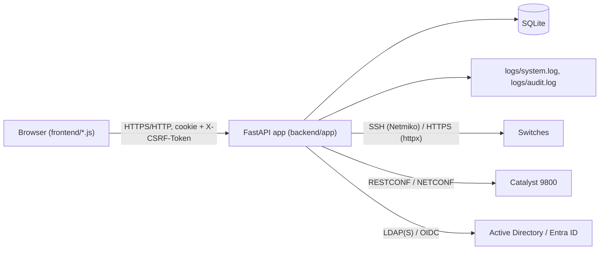
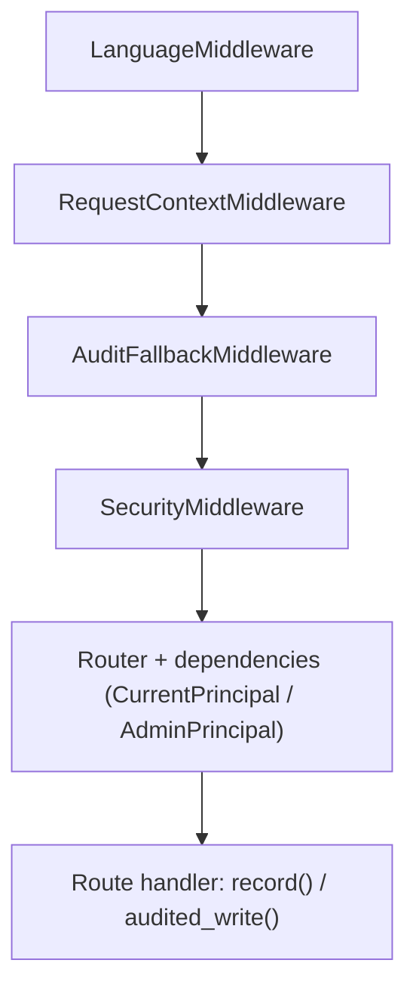

# Architecture

SwitchSteward is a self-hosted web application for managing network switches (SSH/HTTPS) and Cisco Catalyst 9800 WLAN controllers (RESTCONF/NETCONF). It consists of a FastAPI backend with a SQLite database and a framework-free JavaScript frontend served by the same process.

Copyright (C) 2026 Andreas Pulch. SwitchSteward is free software: you can redistribute it and/or modify it under the terms of the GNU General Public License as published by the Free Software Foundation, either version 3 of the License, or (at your option) any later version. See [LICENSE](../LICENSE).

Related documents: [installation.md](installation.md), [configuration.md](configuration.md), [authentication.md](authentication.md), [switch-drivers.md](switch-drivers.md), [wlan-catalyst-9800.md](wlan-catalyst-9800.md), [../SECURITY.md](../SECURITY.md), [../CHANGELOG.md](../CHANGELOG.md).



## Process startup

`python -m app.run` (`backend/app/run.py`) is the launcher:

1. Recovers an interrupted update and applies a pending update (`updates.update_manager`), re-executing itself with the selected Python if needed.
2. If `installation.completed` is not set in `config.json`, it starts the **setup app** (`setup.create_setup_app()`) on `127.0.0.1` only. After the wizard finishes, the server stops and the launcher continues.
3. Otherwise it starts Uvicorn with `app.main:app` using host, port, log level and TLS settings from the configuration.

`backend/app/main.py` is the ASGI entry point: it exposes `application.app` when setup is completed, else the setup app.

The `lifespan` of `application.app` runs, in order: `configure_logging`, `prepare_runtime_files`, `config.validate_file_settings`, SSH configuration validation and legacy SSH policy, `db.init_db()` (creates the database schema if missing), a startup log line including warnings for every enabled insecure option, auditing of the result of a previously installed update (`install-update-result`), `scheduler.recover_jobs()` (jobs interrupted by the last stop or missed by more than 15 minutes fail) and the start of the in-process job scheduler (`scheduler.run_scheduler`, a tick every 30 s that runs due jobs from `scheduler.JOB_HANDLERS` in a pool of 4 threads and deletes expired transfer tokens) and, when enabled, the built-in SFTP transfer server; on shutdown the scheduler task and the SFTP server are stopped.

## Backend modules

All paths relative to `backend/app/`.

| Module / package | Purpose |
|---|---|
| `main.py` | ASGI entry point; selects setup app or configured application. |
| `run.py` | Launcher: update recovery/apply, setup mode, Uvicorn start, restart after update. |
| `application.py` | FastAPI app: routers, middleware stack, exception handlers, lifespan, static file mount, `/` (index with version placeholder `__APP_VERSION__` replaced). |
| `setup.py` | First-run setup wizard app (localhost-only), writes `config.json`, creates the database and first local admin. |
| `manage.py` | CLI `python -m app.manage create-admin --username NAME`: create or restore a local admin account. |
| `config.py` | Loads and validates the JSON runtime configuration (`config.settings`). |
| `bootstrap_config.py` | Creates `config.json` from `config.example.json` with fresh random keys. |
| `runtime_files.py` | Creates missing runtime files on first start (e.g. empty known-hosts files, self-signed certificate). |
| `database.py` | Plain `sqlite3` data access (no ORM): connections, inventory, credentials, audit rows, signed revision tokens; `init_db()`. |
| `schema.py` | Database schema (`_SCHEMA_STATEMENTS`, `SCHEMA_VERSION`). |
| `crypto.py` | Fernet encryption of stored device credentials; key from `secrets.encryption_key` in the configuration. |
| `security.py` | `SecurityMiddleware`: security headers/CSP, body size limits, CSRF check; streaming admin uploads per `UPLOAD_ROUTES` (release archive 50 MiB, firmware image 4 GiB into `<firmware dir>/.incoming`). |
| `request_context.py` | `RequestContextMiddleware` and per-request context (request id, client IP, user, audit flag). |
| `audit.py` | `record()`, `audited_write()`, `@audit_action` and `AuditFallbackMiddleware`. |
| `logging_setup.py` | `system.log`/`audit.log` rotating handlers, console output, request-id filter, secret redaction. |
| `i18n.py` | Backend `t()`, `LanguageMiddleware`, language detection from headers. |
| `i18n_en.py` | `MESSAGES`: English translations keyed by the German message IDs. |
| `release_manifest.py` | Single source of truth for files contained in a release. |
| `updates.py` | Validation and staging of uploaded release archives, recoverable installation, update status. |
| `version.py` | Reads and validates the installed version from `VERSION`. |
| `favicon.py` | Favicon/touch icon routes shared by application and setup wizard. |
| `inventory_routes.py` | `/api`: switch groups, switches, global and per-switch credentials, audit log (admin only). |
| `system_routes.py` | `/api/system`: version/update status, update upload and install. |
| `log_routes.py` | `/api/admin/logs` (admin only): newest `system.log` entries (`GET /system?limit=`, default 500, from the last 2 MiB of the current file) and ZIP downloads of `system.log`/`audit.log` incl. rotated files (`GET /system/download`, `GET /audit/download`). |
| `firmware.py` | Firmware image store (`firmware_images`, files in the configured firmware directory): hashing (SHA-256/MD5), duplicate/name/platform checks, deletion blocked while a pending/running `firmware-stage`/`reload` job uses the image. |
| `firmware_routes.py` | `/api/firmware/images` (admin only): list, streaming upload (`?filename=&platforms=`), delete. |
| `scheduler.py` | In-process scheduler for deferred switch jobs (table `jobs`). |
| `jobs_routes.py` | `/api`: scheduled jobs per switch, overview for administrators, cancelling pending jobs. |
| `backups.py` | Configuration backup store: files in the configured directory plus `config_backups` rows, deduplication and retention. |
| `backup_crypto.py` | Password encryption of backup files. |
| `transfer.py` | One-time download tickets (`transfer_tokens`) through which switches fetch backups and firmware. |
| `transfer_routes.py` | `GET /transfer/{token}/{filename}`: HTTP download of a ticket by a switch (no session). |
| `sftp_server.py` | Built-in read-only SFTP server for platforms that download by SFTP. |
| `system_settings.py` | Operations settings (`operations.backups`, `operations.transfer`, `operations.firmware`) in `app_settings`. |
| `settings_store.py` | Typed settings stored as JSON in `app_settings`. |
| `profile_routes.py` | `/api`: port profiles (admin CRUD and the selection list for the port dialog). |
| `device_locks.py` | Per-device write locks: one change at a time per device, across threads and server processes. |
| `auth/` | Authentication and authorization (see below). |
| `switches/` | Switch device operations and drivers (see below). |
| `wlan/` | WLAN controller integration (see below). |

### `auth/`

| Module | Purpose |
|---|---|
| `__init__.py` | Public API: `Principal`, `Role`, `CurrentPrincipal`, `OperatorPrincipal`, `AdminPrincipal`, `get_current_principal`, `require_operator`, `require_admin`, `require_csrf`, `COOKIE_NAME`. |
| `routes.py` | `/api/auth/methods`, `/api/login` (local/AD), `/api/logout`, `/api/me`, Entra login/callback (`/api/auth/entra/login`, `/api/auth/entra/callback`). |
| `admin_routes.py` | `/api/admin`: auth settings (general/AD/Entra + tests), users, session revocation, group-to-role mappings and operations settings. |
| `sessions.py` | Server-side sessions (SHA-256 of cookie token stored), cookie handling, revocation. |
| `settings.py` | Auth settings in `app_settings`, group mappings. |
| `local.py` / `passwords.py` | Local sign-in; scrypt password hashes. |
| `ldap.py` | Active Directory bind authentication. |
| `entra.py` | Microsoft Entra ID OAuth 2.0 authorization code flow with PKCE + OpenID Connect. |
| `roles.py` | Role resolution for local and external accounts. |
| `users.py` | Persistence of local, AD and Entra accounts. |
| `guards.py` | Lockout guard: at least one admin sign-in path must remain (409 otherwise). |
| `throttle.py` | In-memory login throttling per (client IP, provider, username). |

### `switches/`

| Module | Purpose |
|---|---|
| `routes.py` | `/api`: driver list, capabilities, connection test, interface inventory/detail, change preview/apply, config status, VLAN list, summary, clients, client search, neighbors. |
| `operations.py` | Registry of change operations: every write is previewed as a plan, then applied unchanged; defines role and audit action per operation. |
| `ops/` | Operation modules `ports.py`, `vlans.py`, `vtp.py`, `l2.py`, `security.py`, `device.py`, `config.py`, `backup.py` (and `maintenance.py`, below). |
| `previews.py` | Single-use, expiring change previews kept in server memory. |
| `uplinks.py` | Uplink and management-path detection for the risk check. |
| `config_state.py` | Save state per switch and the armed rollback timer. |
| `backup_service.py`, `backup_routes.py` | Backups of a switch (list, content, download, diff), running/startup comparison, rollback confirm/revert. |
| `device_routes.py`, `l2_routes.py`, `security_routes.py` | Read routes of the Device, Link aggregation/Spanning tree/VTP and Port security tabs. |
| `rollout.py`, `rollout_routes.py` | VLAN rollout to a switch group. |
| `profiles.py` | Global port profiles (table `port_profiles`). |
| `vtp_overview.py` | VTP domain overview across all switches. |
| `service.py` | Facade: selects driver, checks capabilities, coalesces reads. |
| `vlans.py` | Vendor-neutral VLAN tab logic: name validation, port usage per VLAN, delete blockers (default/reserved/layer-3/in use), write verification. |
| `features.py` | Feature IDs and capability resolution (driver ∩ model profile ∩ runtime findings). |
| `catalog.py` | Model catalog types and PoE standard IDs. |
| `clients.py` | Vendor-neutral client correlation, client inventory and global search. |
| `coalescing.py` | Shares overlapping switch reads without caching completed snapshots. |
| `dns.py` | Bounded, cached reverse DNS lookups. |
| `transport.py` | SSH via Netmiko and HTTPS via httpx; connection logging. |
| `validation.py` | Validation of every value interpolated into device commands. |
| `errors.py` | `SwitchConnectionError` (502), `InvalidInputError` (400), `UnsupportedFeatureError` (409). |
| `maintenance_routes.py` | `/api/switches/{id}/firmware` (device firmware state, released images, firmware/reload jobs) and diagnostics reads `/diagnostics/counters`, `/transceivers`, `/environment`, `/cable-test` and `/diagnostics/log` (admin only). |
| `ops/maintenance.py` | Operations `firmware-stage` (deferred job), `firmware-activate`, `reload-now`, `reload-schedule` (deferred `reload` job), `counters-clear`, `cable-test`; registers the scheduler handlers `firmware-stage` and `reload`. |
| `drivers/` | Driver registry and drivers: `cisco/` (IOS/IOS-XE), `aruba_aoscx.py`, `aruba_aoss.py`, `netgear.py`, `mikrotik.py` (REST), model catalogs, `base.py`, `cli.py`. See [switch-drivers.md](switch-drivers.md). |

### `wlan/`

| Module | Purpose |
|---|---|
| `routes.py` | `/api/wlan`: platforms, controllers, credentials, connection test, access points, clients, configuration read/preview/apply. |
| `service.py` | Platform-independent service with filtering and short snapshot cache. |
| `config_service.py` | Reviewed, single-use configuration changes (preview token → apply) with per-controller lock and audit. |
| `config_catalog.py` | Bounded Catalyst 9800 configuration model (IOS XE 17.12 YANG). |
| `models.py` | Shared data models and `Wlan*Error` exceptions. |
| `adapters/` | `catalyst_9800.py` (RESTCONF, read-only), `catalyst_9800_netconf.py` (NETCONF), `netconf_config.py` (guarded configuration workflow), `base.py`. See [wlan-catalyst-9800.md](wlan-catalyst-9800.md). |

## Request flow

Starlette runs the middleware added last as the outermost layer. `application.py` adds `SecurityMiddleware`, `AuditFallbackMiddleware`, `RequestContextMiddleware`, `LanguageMiddleware` in that order, so a request passes through:



| Layer | Behaviour |
|---|---|
| `LanguageMiddleware` (`i18n.py`) | Sets `current_language` from `X-UI-Language`, else the first `Accept-Language` tag, else `de`. Outermost so that rejections from inner middleware are translated. |
| `RequestContextMiddleware` (`request_context.py`) | Creates the context (`request_id` = 12 hex chars, `client_ip`, `username`, `auth_provider`, `audited`), adds `X-Request-ID` to the response and writes one `switchsteward.http` log line per request (method, path without query string, status, duration, user, IP). Static assets and favicons are not logged. |
| `AuditFallbackMiddleware` (`audit.py`) | For mutating (`POST/PUT/PATCH/DELETE`) `/api/` requests: if the response is ≥ 400 and the route has not recorded an audit entry, writes one (see [fallback](#fallback-behaviour)). |
| `SecurityMiddleware` (`security.py`) | Adds security headers to every response (including rejections); for `/api/` checks `Content-Length`, enforces body limits, CSRF and streams update uploads. |

**Security headers** (all responses): `X-Content-Type-Options: nosniff`, `X-Frame-Options: DENY`, `Referrer-Policy: same-origin`, `Permissions-Policy: camera=(), microphone=(), geolocation=()`, and

```
Content-Security-Policy: default-src 'self'; script-src 'self'; style-src 'self' 'unsafe-inline';
  connect-src 'self'; img-src 'self' data:; object-src 'none'; base-uri 'none';
  frame-ancestors 'none'; form-action 'self'
```

`/api/` responses add `Cache-Control: no-store`; HTTPS requests add `Strict-Transport-Security: max-age=31536000; includeSubDomains`. App-supplied copies of these headers are replaced.

**Body limit**: `application.api_max_body_bytes` for API requests (both `Content-Length` and the actually buffered body; chunked bodies are buffered only up to the limit). `POST /api/system/updates` uses `updates.MAX_UPLOAD_BYTES` and is streamed to a temporary file only after authentication, CSRF and admin checks.

**CSRF**: every mutating `/api/` request except `/api/login` must carry `X-CSRF-Token` matching the session's token (`auth.require_csrf`); missing session → 401, wrong token → 403. The token is returned by `/api/login` and `/api/me`.

**Host check**: only the setup app checks the host. Its `_SetupGuard` accepts requests only from a loopback peer with `Host` `localhost`, `127.0.0.1` or `[::1]`, requires a matching `Origin` for POST, limits bodies to 64 KiB and sets its own strict headers (`style-src 'self'`, `Referrer-Policy: no-referrer`). Setup middleware order: `RequestContextMiddleware` > `LanguageMiddleware` > `_SetupGuard`; it has no audit fallback because no database is configured yet. The main application relies on the configured bind address and, if used, a reverse proxy (see [configuration.md](configuration.md)).

**Authentication dependencies** (`auth/__init__.py`):

- `CurrentPrincipal` → `get_current_principal`: reads the session cookie, validates it against the `sessions` table (unexpired, account enabled), stores user/provider in the request context; 401 otherwise.
- `OperatorPrincipal` → `require_operator`: requires role `admin` or `operator`; used by `POST /api/switches/{id}/changes/preview` and `/changes/apply`, where the operation decides whether an operator may run it.
- `AdminPrincipal` → `require_admin`: additionally requires role `admin`; 403 otherwise. Used by every other mutating route except `/api/login` and `/api/logout`, and by reads of credentials metadata (including `GET /api/credentials`), the audit log, system logs, users, mappings and auth settings.

**Exception handlers** (`application.py`): request validation → 422 without echoing input values; `InvalidInputError` → 400; `UnsupportedFeatureError` → 409 `{message, code: "incompatible", feature}`; `SwitchConnectionError` → 502; `WlanConfigurationError`/`UnsupportedPlatformError` → 400; other `WlanError` → 502; any other exception → 500 with translated message containing the request id and an `X-Request-ID` header.

**Static files**: `/static` serves only top-level `.html`, `.css`, `.js` files from `frontend/`. `/` returns `index.html` with `__APP_VERSION__` replaced for cache busting.

## Data model

SQLite, accessed through `database.get_conn()` (`PRAGMA foreign_keys = ON`, commit on success, rollback on error). Device secrets are stored Fernet-encrypted (`*_enc` columns).

| Table | Purpose | Key columns |
|---|---|---|
| `switch_groups` | Grouping of switches | `name` (unique, case-insensitive) |
| `switches` | Switch inventory | `name` (unique), `ip`, `port`, `device_type` (driver), `group_id`, `credential_mode` (`global`/`device`), `credential_revision`, `model_id`, `detected_model`, `detected_model_id`, `detected_at` |
| `credentials` | Global device credentials (single row, `id = 1`) | `username`, `password_enc`, `enable_secret_enc` |
| `switch_credentials` | Per-switch credentials | `switch_id`, `username`, `password_enc`, `enable_secret_enc` |
| `wlan_controllers` | WLAN controller inventory | `name`, `host`, `port`, `platform` (`catalyst_9800`), `transport` (`restconf`/`netconf`), `credential_mode`, `controller_revision`, `credential_revision` |
| `wlan_credentials` | Per-controller credentials | `controller_id`, `username`, `password_enc` |
| `wlan_config_state` | Persistence status of this application's WLC changes | `controller_id`, `connection_fingerprint`, `status`, `last_change_id`, `last_saved_at` |
| `audit_log` | Audit trail shown in the GUI | `ts`, `username`, `switch_name` (historical name; stores any target), `interface`, `action`, `detail`, `status`, `auth_provider`, `client_ip`, `request_id` |
| `users` | Local, AD and Entra accounts | `provider` (`local`/`ad`/`entra`), `subject`, `username`, `password_hash` (local only), `assigned_role` (`admin`/`operator`/`viewer`), `enabled`, `last_role`, `last_login_at`; unique `(provider, subject)` |
| `sessions` | Server-side sessions | `id` (SHA-256 of cookie token), `user_id`, `role` (`admin`/`operator`/`viewer`), `csrf_token`, `expires_at`, `last_seen_at` |
| `group_role_mappings` | Directory group → role | `provider` (`ad`/`entra`), `group_id`, `label`, `role` (`admin`/`operator`/`viewer`) |
| `app_settings` | Settings held in the database | `key`, `value` (JSON), `updated_at`; used for `auth.general`, `auth.ad`, `auth.entra` and `operations.*` |
| `jobs` | Deferred and scheduled switch jobs | `kind`, `switch_id`, `run_at`, `params` (JSON), `status`, `result`, `created_by` |
| `switch_config_state` | Save state of changes made through SwitchSteward | `switch_id`, `status` (`untracked`/`dirty`/`saved`/`unknown`), `last_change_at`, `last_change_by`, `last_saved_at` |
| `switch_rollbacks` | Armed rollback timer per switch | `switch_id`, `mechanism`, `armed_at`, `expires_at`, `armed_by` |
| `config_backups` | Configuration backup index | `switch_id`, `created_at`, `trigger`, `source`, `path`, `encrypted`, `sha256`, `size`, `created_by` |
| `transfer_tokens` | One-time download tickets | `token_id`, `secret_hash`, `kind`, `ref_id`, `switch_id`, `filename`, `expires_at`, `uses`, `max_uses` |
| `port_profiles` | Global port profiles | `name`, `description`, `settings`, `updated_by` |
| `firmware_images` | Uploaded firmware images | `filename`, `size`, `sha256`, `md5`, `platforms`, `uploaded_by`, `uploaded_at` |

### Schema versioning

`schema.initialize_schema()` runs inside one transaction (`BEGIN IMMEDIATE`) on every start (and in the setup wizard and `manage.py`): it creates all tables and indexes with `CREATE … IF NOT EXISTS` and sets `PRAGMA user_version` to `SCHEMA_VERSION` (1). Later releases add versioned migrations on top of this baseline.

### Sessions and settings

- Sessions are server-side only; the cookie (`HttpOnly`, `SameSite=Strict`, `Secure` per `session.cookie_secure`) carries a random token whose SHA-256 is the row id. Expiry is absolute (`session.max_age_seconds`), no sliding renewal. Sessions are revoked when an account is disabled, its role changes, or its provider is switched off. See [authentication.md](authentication.md).
- Authentication settings live in `app_settings` and are edited in the administration workspace, not in `config.json`. `settings_store.load/store` read and write these typed JSON values (an invalid stored value falls back to the model defaults).
- Operations settings (administration → "Betrieb", `system_settings.py`) use the keys `operations.backups` (directory, retention 1–1000, encryption `none`/`password` with the password stored encrypted with the application key), `operations.transfer` (address under which switches reach SwitchSteward, token validity, built-in SFTP server) and `operations.firmware` (image directory). Relative directories resolve against the directory of `config.json`; `system_settings.storage_dir()` refuses directories inside `backend/app`, `frontend` or `.updates` and checks writability on save and before each use.
- Configuration backups (`backups.py`): files `<directory>/<switch_id>/<UTC>-<trigger>.cfg` (mode 0600, folders 0700) plus a `config_backups` row with the absolute path and the SHA-256 of the normalized text; a backup identical to the latest one is skipped, only the newest `retention` backups per switch are kept. Password mode writes `.cfg.smbk` files (`backup_crypto.py`: `SMBK1` header, scrypt n=32768 r=8 p=1, Fernet); `python -m app.manage decrypt-backup FILE` decrypts one offline. Changing the mode or password converts all existing files first (all-or-nothing) and only then stores the setting.
- Backup triggers: `save-config` stores the startup configuration before and after saving, `config-restore` before restoring; MikroTik (no save step) stores the running configuration before and after every configuration change (`switches/ops/backup.py`). Backup failures become warnings and never abort the change. `GET /api/switches/{id}/backups[/{bid}[/download|/diff?against=<bid>|running|startup]]` list, show (admin), download (admin) and diff (admin, `difflib` on normalized texts, max. 5000 lines) backups; `GET …/config-status?compare=1` compares running and startup on the device and updates the save state.
- File transfer to switches (`transfer.py`): one-time tickets in `transfer_tokens` (`token_id` + 24-char secret, only its SHA-256 stored; backups 15 min/3 uses, firmware `token_minutes`/5 uses). Cisco and MikroTik download via `GET /transfer/{token_id}.{secret}/{filename}` (`transfer_routes.py`, no session, `Cache-Control: no-store`, invalid → 404); AOS-CX, AOS-S and Netgear via the built-in read-only SFTP server (`sftp_server.py`, paramiko; user `t{token_id}`, password = secret; the session sees only its ticket file; RSA 3072 host key `sftp_host_rsa.key` next to the database; max. 8 connections, 30 s login, 3 password attempts, 300 s idle). It is started by the lifespan when enabled and restarted when the transfer settings change (a bind failure keeps the previous settings, 400). Plan lines show tokens as `********`; previews use placeholder tickets.

## Frontend

Plain HTML, CSS and JavaScript in `frontend/`; no framework, no build step, no inline scripts (required by `script-src 'self'`). Scripts share globals and are loaded in a fixed order by `index.html`: `theme.js` (head), then `i18n.js`, `i18n.en.js`, `core.js`, `switches.js`, `switch-security.js`, `switch-l2.js`, `switch-backups.js`, `switch-device.js`, `switch-maintenance.js`, `switch-diagnostics.js`, `wlan.js`, `admin.js`, `main.js`.

| File | Purpose |
|---|---|
| `index.html` | Application shell: login, top bar, workspace navigation, modals; static texts carry `data-i18n*` attributes. |
| `setup.html`, `setup.js`, `setup.css` | First-run setup wizard (loaded by the setup app with `i18n.js`/`i18n.en.js`). |
| `core.js` | `api()` and `apiDownload()` helpers (add `X-UI-Language` and `X-CSRF-Token`), session state, session hooks, workspace router, shared UI helpers (incl. `makeColumnsResizable()`), software update page logic, `bootstrap()`. |
| `main.js` | Calls `bootstrap()`. |
| `switches.js` | Switch workspace: inventory, groups, tab registry, interfaces, VLANs, summary, neighbors, clients, change preview/apply dialog, credentials (incl. the global credentials page). |
| `switch-security.js` | Port security tab and port-profile application. |
| `switch-l2.js` | Link aggregation, spanning tree and VTP tabs, VTP domain overview, VLAN rollout. |
| `switch-backups.js` | Backups tab: list, view, diff, download, restore. |
| `switch-device.js` | Device tab: identity, services, access, layer 3, ACLs, QoS. |
| `switch-maintenance.js` | Maintenance tab: firmware staging/activation and reloads. |
| `switch-diagnostics.js` | Diagnostics tab: counters, transceivers, environment, log, cable test. |
| `wlan.js`, `wlan.css` | WLAN workspace: controllers, access points, clients, configuration. |
| `admin.js` | Administration workspace (admins only): sign-in settings, users, group mappings, global credentials, operations (backups, transfer, firmware, jobs), port profiles, audit log, system log, software update. |
| `theme.js` | Dark/light theme from `localStorage` (`switchsteward.theme`). |
| `i18n.js`, `i18n.en.js` | Frontend translation (see below). |
| `app.css` | Main stylesheet. |

**Workspace router** (`core.js`): modules call `registerWorkspace(name, { navButtonId, sidebarId, onEnter, onLeave, isAvailable })`; `setWorkspaceMode(name)` switches workspaces (falling back to `switches` if `isAvailable()` returns false) and calls `onLeave`/`onEnter`; `resetWorkspaceMode()` returns to `switches` without callbacks; `isWorkspaceActive(name)` queries the state. Registered workspaces: `switches`, `wlan`, `admin`.

**Session hooks**: `registerSessionHooks({...})` with optional hooks `applySessionUi`, `rerenderRoleSensitiveContent`, `clearSensitiveFields`, `closePrivilegedModals`, `reset`, `credentialsChanged`; `core.js` runs them via `runSessionHooks(name)` on login, logout, role change and credential changes, so each module clears its own sensitive state.

## Internationalization

German text is the message ID in both frontend and backend; English is the only translation.

| | Frontend | Backend |
|---|---|---|
| Lookup | `t(msgid, params)` in `i18n.js`, catalog `window.I18N_EN` (`i18n.en.js`) | `t(msgid, **params)` in `i18n.py`, catalog `MESSAGES` (`i18n_en.py`) |
| Placeholders | `{name}` | `{name}` (`str.format`) |
| Missing key | German text is shown | German text is returned |
| Static HTML | `data-i18n`, `data-i18n-placeholder`, `data-i18n-title`, `data-i18n-aria-label` applied by `applyStaticTranslations()` | – |

**Language selection**

- Frontend: `localStorage` key `switchsteward.language` (`de`/`en`); without a stored value, `navigator.language` starting with `de` selects German, anything else English. Buttons with `data-language-toggle` call `setUiLanguage()`, which stores the choice and reloads the page.
- Backend: per request from `X-UI-Language` (sent by `api()` and `setup.js`), else the first `Accept-Language` tag, else German (`DEFAULT_LANGUAGE = "de"`).

Log files and audit records are not translated: log messages are English, and audit `action` values are fixed identifiers (some `detail` texts are German).

## Logging

Configured by `logging_setup.configure_logging()` from the `logging` section (`directory`, default `logs`; `level`; `max_bytes`; `backup_count`) and `server.log_level` for the console. Both files rotate (`RotatingFileHandler`).

| Output | Content | Level |
|---|---|---|
| `system.log` | `%(asctime)s %(levelname)s %(name)s [%(request_id)s] %(message)s` — request lines (`switchsteward.http`), startup/shutdown, device connections, errors | `logging.level` (`info`, `warning`, `error`) |
| Console | Same format | `server.log_level` |
| `audit.log` | One JSON object per line: `ts`, `username`, `auth_provider`, `client_ip`, `target`, `interface`, `action`, `detail`, `status`, `request_id` | Always INFO, independent of `logging.level`; not propagated to `system.log` |
| `audit_log` table | Same record, displayed via `GET /api/audit-log` (latest `application.audit_log_limit` rows, admin only) | – |

Every log record carries the request id (`-` outside requests), which also appears in the `X-Request-ID` response header and in audit records, so a GUI error can be correlated with `system.log` and `audit.log`. A redaction filter masks values of `password`, `secret`, `token`, `authorization`, `cookie` and `code` keys. `paramiko`, `netmiko`, `httpx`, `httpcore`, `ldap3` are limited to WARNING; `uvicorn.access` is disabled.

`audit.record()` writes the database row first (failure raises and is logged), then the `audit.log` line, then marks the request as audited.

## Release manifest

`backend/app/release_manifest.py` is a pure data module (no `app` imports) and the single source of truth for release contents:

| Name | Content |
|---|---|
| `DOC_FILES` | `VERSION`, `README.md`, `CHANGELOG.md`, `SECURITY.md`, `LICENSE` |
| `BACKEND_FILES` | `backend/config.example.json`, `backend/requirements.txt`, `backend/start.ps1`, `backend/start.sh` |
| `REQUIRED_FRONTEND_FILES` | The 14 frontend files (`index.html` … `setup.js`) |
| `REQUIRED_MODULES` | Backend modules required for start and update (`application.py`, `run.py`, `setup.py`, `updates.py`, …) |
| `FRONTEND_PATTERN` | `frontend/<name>.html`, `.css` or `.js` directly in `frontend/` |
| `DOC_PATTERN` | `docs/<name>.md` directly in `docs/` |

Consumers:

- `scripts/build_release.py` loads the file by path, fails if a required file is missing, and packs `DOC_FILES`, `BACKEND_FILES`, required frontend files, files matching `FRONTEND_PATTERN`/`DOC_PATTERN`, and all `backend/app/**/*.py` (without `__pycache__`) into `dist/switchsteward.zip` and `dist/switchsteward.tar.gz` (root folder `switchsteward/`, reproducible timestamps, `start.sh` executable with LF line endings). The `docs/*.md` files and `LICENSE` are therefore part of every release.
- `updates.py` accepts in an uploaded archive only names that are fixed files, match `FRONTEND_PATTERN`/`DOC_PATTERN`, or are backend Python modules, and rejects archives missing any of the fixed files or `REQUIRED_MODULES`.
- `setup.py` checks that all `REQUIRED_FRONTEND_FILES` exist in the frontend directory.

## Audit action catalog

Every mutating route is decorated with `@audit_action("…")` (the name used by the fallback); the route itself writes the outcome with `audit.record()` or `audit.audited_write()`. Status is `ok` or `error` unless noted. Target = `switch_name` column.

### Authentication and administration

| Action | Trigger | Meaning |
|---|---|---|
| `login` | `POST /api/login`, `GET /api/auth/entra/callback` | Successful sign-in; detail `role=…`, provider in `auth_provider`. |
| `login-failed` | Same as above | Failed sign-in, status `error`; detail `reason=` `invalid_credentials`, `disabled`, `no_role`, `throttled` or `unavailable`. |
| `logout` | `POST /api/logout` | Session deleted. |
| `auth-settings-update` | `PUT /api/admin/auth-settings/general`, `/ad`, `/entra` | Sign-in settings changed; target `general`/`ad`/`entra`, revoked session count, Entra secret `set`/`cleared`/`kept`. |
| `auth-ad-test` | `POST /api/admin/auth-settings/ad/test` | AD test login with stored settings; target `ad`. |
| `auth-entra-test` | `POST /api/admin/auth-settings/entra/test` | Entra metadata (discovery) check; target `entra`. |
| `user-create` | `POST /api/admin/users`; `manage.py create-admin` (new account, user `cli`) | Local account created. |
| `user-update` | `PUT /api/admin/users/{id}`; `manage.py create-admin` (existing account, user `cli`) | Account changed; detail lists changed fields and revoked sessions. |
| `user-delete` | `DELETE /api/admin/users/{id}` | Account deleted. |
| `sessions-revoke` | `POST /api/admin/users/{id}/revoke-sessions` | Sessions of a user revoked. |
| `mapping-create` | `POST /api/admin/group-mappings` | Group-to-role mapping created; target = provider. |
| `mapping-update` | `PUT /api/admin/group-mappings/{id}` | Mapping changed. |
| `mapping-delete` | `DELETE /api/admin/group-mappings/{id}` | Mapping deleted. |
| `port-profile-create` / `port-profile-update` / `port-profile-delete` | `POST /api/admin/port-profiles`, `PUT`/`DELETE /api/admin/port-profiles/{id}` | Port profile created, changed or deleted; target = profile name, detail `id=<id>`. |

### Switch inventory and devices

| Action | Trigger | Meaning |
|---|---|---|
| `create-switch-group` | `POST /api/switch-groups` | Group created. |
| `update-switch-group` | `PUT /api/switch-groups/{id}` | Group renamed. |
| `delete-switch-group` | `DELETE /api/switch-groups/{id}` | Group deleted. |
| `create-switch` | `POST /api/switches` | Switch added (IP, port, device type, model). |
| `update-switch` | `PUT /api/switches/{id}` | Switch changed. |
| `delete-switch` | `DELETE /api/switches/{id}` | Switch removed. |
| `update-credentials` | `POST /api/credentials` | Global device credentials set. |
| `update-switch-credentials` | `PUT /api/switches/{id}/credentials` | Per-switch credential mode/credentials set; `error` on stale revision or missing password. |
| `test-connection` | `POST /api/switches/{id}/test-connection` | Connection test result. |
| `switch-change-preview` | `POST /api/switches/{id}/changes/preview` | Change preview built (plan read from the device, nothing sent); detail `kind=<operation>`, interface column for port operations. Failed previews (invalid input, incompatible, risk refused) appear via the fallback. |
| `switch-change` | Decorator name of `POST /api/switches/{id}/changes/apply` | Only appears via the fallback (e.g. `409` with code `preview_invalid`, `preview_stale`, `risk_confirmation_required`, `rollback_pending`); a successful apply records the operation's own action below. |
| `configure-interface` | Apply of operation `port-configure` | Interface configuration write (via `audited_write`); detail = set fields, `commands=<n>` (and `rollback=<m>m` when armed). |
| `port-enable` / `port-disable` | Apply of operation `port-state` | Port enabled/disabled (via `audited_write`); detail `commands=<n>`. |
| `save-config` | Apply of operation `save-config` | Running configuration saved; save state becomes `saved`. |
| `config-backup` | Apply of `save-config` (before/after saving, startup configuration), `config-restore` (before, startup) and every MikroTik configuration change (before/after, running configuration) | Configuration backup stored; detail `trigger=<trigger> id=<backup id>`. A failed backup never aborts the change: status `error`, detail `trigger=<trigger> error=<message>`, plus a warning in the apply result. Unchanged configurations are not stored again (no record). |
| `config-restore` | Apply of operation `config-restore` | Backup loaded into the startup configuration by the switch (transfer ticket) and switch restarted; detail `backup_id=<id> commands=<n>`; save state becomes `unknown`. |
| `download-config-backup` | `GET /api/switches/{id}/backups/{bid}/download` | Backup content downloaded by an admin; detail `id=<backup id>`. |
| `rollback-confirm` / `rollback-revert` | `POST /api/switches/{id}/rollback/confirm`, `/rollback/revert` | Armed rollback timer confirmed (change kept) or reverted now (via `audited_write`); detail `mechanism=<driver> commands=<n>`; `error` (fallback, `409` code `rollback_none`) when no rollback is armed. |
| `transfer-download` | `GET /transfer/{token}/{filename}` and SFTP `open` (built-in SFTP server), user `system` | A switch downloaded a transfer ticket's file; detail `kind=backup\|firmware ref=<id> protocol=http\|sftp client_ip=<ip>`; `error` when the payload is unavailable. Invalid tickets are not audited (HTTP 404 / SFTP login refused, logged as warning). |
| `create-vlan` | Apply of operation `vlan-create` | VLAN created (detail `vlan=<id> name='<name>' commands=<n>`, via `audited_write`, verified by a fresh VLAN read). |
| `rename-vlan` | Apply of operation `vlan-rename` | VLAN renamed (via `audited_write`). |
| `delete-vlan` | Apply of operation `vlan-delete` | VLAN deleted. Blocked deletions (VLAN in use, default/reserved, layer-3 interface) already fail in the preview. |
| `set-vlan-voice` | Apply of operation `vlan-voice` | VLAN marked/unmarked as voice VLAN (AOS-CX, AOS-S); detail `vlan=<id> voice=<bool>`. |
| `port-bounce` / `poe-cycle` / `errdisable-recover` | Apply of operations `port-bounce`, `poe-cycle`, `errdisable-recover` | Port restarted, PoE power cycled, protection-disabled port re-enabled (operators allowed on non-uplink access ports); no save-state change. |
| `create-lag` / `update-lag` / `delete-lag` | Apply of operations `lag-create`, `lag-update`, `lag-delete` | Link aggregation created (detail `lag_id`, `mode`, `members`), members added/removed, or deleted. |
| `set-stp-mode` / `set-stp-priority` / `set-stp-mst` / `set-stp-port` | Apply of operations `stp-mode`, `stp-priority`, `stp-mst`, `stp-port` | Spanning-tree mode, bridge priority, MST region or port cost/priority changed. |
| `set-vtp` / `vtp-primary` | Apply of operations `vtp-configure`, `vtp-primary` (Cisco) | VTP domain, version, mode, pruning or password changed (the password is never logged), or the switch took over the VTPv3 primary server role. VTP lives in `vlan.dat`, so these changes offer no configuration rollback. |
| `configure-port-security` | Apply of operation `port-security-configure` | Port security settings of a port changed (port security, 802.1X/MAB, STP guards, storm control, DHCP/DAI trust, IP source guard); detail = set blocks. |
| `configure-security-global` | Apply of operation `security-global-configure` | Global DHCP snooping, DAI VLANs or 802.1X changed. |
| `apply-port-profile` | Apply of operation `profile-apply` | Port profile applied to a port; detail `profile=<name>`. |
| `set-device-identity` / `set-device-services` | Apply of operations `device-identity`, `device-services` | Hostname, banner, SNMP location/contact, or NTP/time zone/DNS/domain/syslog changed; detail = set fields (banner only as length). |
| `set-snmp-user` / `delete-snmp-user` | Apply of operations `device-snmp-user-set`, `device-snmp-user-delete` | SNMPv3 user created/changed or deleted; keys are never logged. |
| `set-device-aaa` | Apply of operation `device-aaa` | RADIUS/TACACS+ servers or login order changed (local fallback enforced); keys are never logged. |
| `set-device-user` / `delete-device-user` | Apply of operations `device-user-set`, `device-user-delete` | Local device user created/changed or deleted (never SwitchSteward's own account); passwords are never logged. |
| `set-device-ssh` | Apply of operation `device-ssh` | SSH idle timeout, Telnet or web access changed. |
| `set-svi` / `delete-svi` / `set-default-gateway` / `add-static-route` / `delete-static-route` | Apply of operations `l3-svi-set`, `l3-svi-delete`, `l3-gateway`, `l3-route-add`, `l3-route-delete` | IPv4 VLAN interface, DHCP relay, default gateway or static route changed. |
| `create-acl` / `delete-acl` / `add-acl-entry` / `delete-acl-entry` / `bind-acl` / `unbind-acl` | Apply of operations `acl-create`, `acl-delete`, `acl-entry-add`, `acl-entry-delete`, `acl-bind`, `acl-unbind` | Named IPv4 ACL, entry or binding (port or VLAN interface, in/out) changed. |
| `set-qos-port` | Apply of operation `qos-port` | Port QoS trust or voice preset changed. |
| `vlan-rollout-preview` | `POST /api/switch-groups/{id}/vlan-rollout/preview` | VLAN rollout preview for a switch group; target `group:<id>`, detail `vlan=<id>`. |
| `vlan-rollout` | `POST /api/switch-groups/{id}/vlan-rollout/apply` | One record per selected switch: detail `vlan=<id> ports=<list> commands=<n>`; `error` for a failed, stale or locked switch (the others continue). |

Device routes record `<action>` with detail `credentials_missing` and status `error` when the selected credential source has no credentials. `audited_write` records `error` with detail `… -> FEHLER` when the device operation raises. Every write is a preview/apply pair: the apply re-reads the device, rebuilds the plan and refuses it (`preview_stale`) when the lines or the port mode differ from the preview.

### WLAN

| Action | Trigger | Meaning |
|---|---|---|
| `create-wlan-controller` | `POST /api/wlan/controllers` | Controller added. |
| `update-wlan-controller` | `PUT /api/wlan/controllers/{id}` | Controller changed; `error` if the revision is stale. |
| `delete-wlan-controller` | `DELETE /api/wlan/controllers/{id}` | Controller removed. |
| `update-wlan-credentials` | `PUT /api/wlan/controllers/{id}/credentials` | Controller credentials set; `error` on stale revision, parallel connection change or removed credentials. |
| `test-wlan-connection` | `POST /api/wlan/controllers/{id}/test-connection` | Connection test result. |
| `wlan-config-preview` | `POST /api/wlan/controllers/{id}/configuration/preview` | Change preview created; only resource, operation and key are logged (values may contain PSKs). |
| `wlan-config-start` | `POST /api/wlan/controllers/{id}/configuration/apply` | Journal entry written **before** dispatch, status `pending`; detail JSON with `change_id`, change and diff. |
| `wlan-config-result` | Same request, after dispatch | Outcome; status `applied`, `rejected`, `partial` or `unknown`; detail adds verification and persistence state. |

### System and setup

| Action | Trigger | Meaning |
|---|---|---|
| `upload-update` | `POST /api/system/updates` | Release archive staged (version, SHA-256) or rejected. |
| `install-update` | `POST /api/system/updates/install` | Installation requested; restart follows. |
| `install-update-result` | Application startup (`lifespan`), user `system` | Result of the previously installed update. |
| `setup-complete` | `POST /api/setup` (setup wizard) | Initial setup saved; written directly into the new database with the new admin as actor. |
| `download-system-log` | `GET /api/admin/logs/system/download` | ZIP of `system.log` and rotated files delivered; detail `files=<count>`. |
| `download-audit-log` | `GET /api/admin/logs/audit/download` | ZIP of `audit.log` and rotated files delivered; detail `files=<count>`. |

### Operations and scheduled jobs

| Action | Trigger | Meaning |
|---|---|---|
| `operations-settings-update` | `PUT /api/admin/operations-settings/backups`, `/transfer`, `/firmware` | Operations settings changed; target `backups`/`transfer`/`firmware`. Backups: detail `directory=… retention=… encryption=… password=changed\|kept converted=<files>` (the password itself is never logged). |
| `job-cancel` | `DELETE /api/jobs/{id}` | Pending job cancelled; detail `job=<id> kind=<kind> run_at=<UTC>`; `error` (fallback) for unknown or no longer pending jobs. |
| `upload-firmware` | `POST /api/firmware/images?filename=…&platforms=…` | Firmware image stored (streamed upload, max. 4 GiB into `<firmware dir>/.incoming`, then moved); target = file name, detail `size=… sha256=… platforms=…`; `error` for invalid name/platforms or duplicates (409). |
| `delete-firmware` | `DELETE /api/firmware/images/{id}` | Firmware image deleted; target = file name; `error` (409) while a pending/running `firmware-stage` or `reload` job uses it. |
| `firmware-stage` | Apply of operation `firmware-stage` | Deferred: creates a `firmware-stage` job (detail `image_id=… commands=<n> job=<id> run_at=<UTC>`); the job issues the transfer ticket, downloads/verifies the image and is audited as `job-firmware-stage`. |
| `firmware-activate` | Apply of operation `firmware-activate` | Next boot image set (`reload` `none`/`now`/`at`); `at` schedules a `reload` job, in Cisco install mode the job runs the activation itself. |
| `reload` | Apply of operation `reload-now` | Switch restarted without saving; save state becomes `unknown`. |
| `schedule-reload` | Apply of operation `reload-schedule` | Deferred: creates a `reload` job at `run_at` (2 min – 30 days ahead); outcome audited as `job-reload`. |
| `clear-counters` | Apply of operation `counters-clear` | Port counters reset (operators allowed on access ports). |
| `cable-test` | Apply of operation `cable-test` | Cable test started; results via `GET /api/switches/{id}/diagnostics/cable-test`. |
| `job-<kind>` | Scheduler (`scheduler.py`) and startup recovery, user `system` | Outcome of a scheduled job of that kind (e.g. `job-reload`); detail `job=<id> <message>`; jobs interrupted by a server stop or missed by more than 15 minutes are recorded as `error`. |

### Fallback behaviour

`AuditFallbackMiddleware` handles mutating `/api/` requests that end with status ≥ 400 (or an exception, treated as 500) without any `record()` call during the request:

| Status | Audit entry |
|---|---|
| 401 | No audit entry; warning `Rejected unauthenticated …` in `system.log`. |
| 403 | Action `access-denied`, status `error`, detail `route_action=<decorator name> http_status=403` (e.g. viewer calling an admin route, invalid CSRF token). |
| other ≥ 400 | Action = the route's `@audit_action` name, status `error`, detail `http_status=<code>` (validation errors, 404, 409 conflicts, 502). |

If no route was resolved (the request was rejected before routing, e.g. by `SecurityMiddleware` for CSRF or body size), the route name is `request`, so the entry is `access-denied` with `route_action=request` or action `request`. A failure to write the fallback record does not change the response.

In total the catalog contains **104 action names** plus the `job-<kind>` family: 101 recorded explicitly by routes, startup or the CLI (`login`, `login-failed`, `logout`, `auth-settings-update`, `auth-ad-test`, `auth-entra-test`, `user-create`, `user-update`, `user-delete`, `sessions-revoke`, `mapping-create`, `mapping-update`, `mapping-delete`, `create-switch-group`, `update-switch-group`, `delete-switch-group`, `create-switch`, `update-switch`, `delete-switch`, `update-credentials`, `update-switch-credentials`, `test-connection`, `switch-change-preview`, `configure-interface`, `port-enable`, `port-disable`, `save-config`, `create-vlan`, `rename-vlan`, `delete-vlan`, `set-vlan-voice`, `port-bounce`, `poe-cycle`, `errdisable-recover`, `create-lag`, `update-lag`, `delete-lag`, `set-stp-mode`, `set-stp-priority`, `set-stp-mst`, `set-stp-port`, `set-vtp`, `vtp-primary`, `create-wlan-controller`, `update-wlan-controller`, `delete-wlan-controller`, `update-wlan-credentials`, `test-wlan-connection`, `wlan-config-preview`, `wlan-config-start`, `wlan-config-result`, `upload-update`, `install-update`, `install-update-result`, `setup-complete`, `download-system-log`, `download-audit-log`, `operations-settings-update`, `job-cancel`, `config-backup`, `config-restore`, `download-config-backup`, `rollback-confirm`, `rollback-revert`, `transfer-download`, `configure-port-security`, `configure-security-global`, `apply-port-profile`, `port-profile-create`, `port-profile-update`, `port-profile-delete`, `set-device-identity`, `set-device-services`, `set-snmp-user`, `delete-snmp-user`, `set-device-aaa`, `set-device-user`, `delete-device-user`, `set-device-ssh`, `set-svi`, `delete-svi`, `set-default-gateway`, `add-static-route`, `delete-static-route`, `create-acl`, `delete-acl`, `add-acl-entry`, `delete-acl-entry`, `bind-acl`, `unbind-acl`, `set-qos-port`, `vlan-rollout-preview`, `vlan-rollout`, `upload-firmware`, `delete-firmware`, `firmware-stage`, `firmware-activate`, `reload`, `schedule-reload`, `clear-counters`, `cable-test`) and 3 that only the fallback writes (`switch-change`, `access-denied`, `request`).
