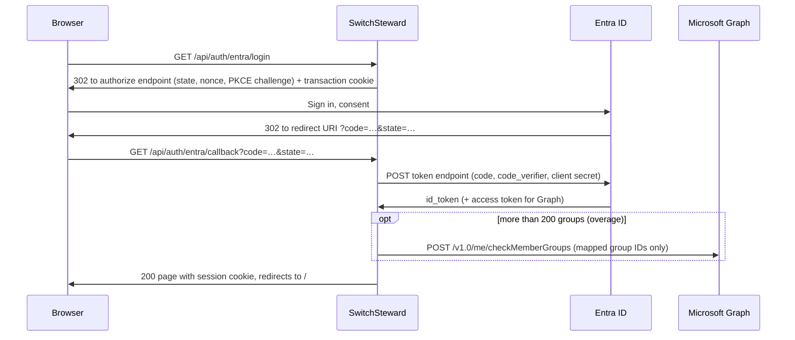

# Authentication and access control

SwitchSteward supports three sign-in methods:

| Method | Status | Configured in |
| --- | --- | --- |
| Local accounts | always active; individual accounts can be disabled | setup wizard, **Administration → Users**, emergency CLI |
| Active Directory (LDAP bind) | optional | **Administration → Authentication** |
| Microsoft Entra ID (OAuth 2.0 / OpenID Connect) | optional | **Administration → Authentication** |

All authentication settings, users, sessions and group mappings are stored in the
SQLite database, not in `config.json`. Only administrators see the
**Administration** workspace. Every change made there is
[audited](#sign-in-audit).

## Roles

There are three roles:

| Role | UI name | Permissions |
| --- | --- | --- |
| `admin` | Administrator | Everything: inventory, device credentials, switch, VLAN and WLAN configuration, and the Administration workspace (sign-in settings, users, mappings, global credentials, audit log, system log, software update). |
| `operator` | Operator | Everything a viewer can read. On access ports that are not uplinks: description, access VLAN, voice VLAN, administrative state, PoE mode and power profile, speed/duplex; restart a port, power-cycle PoE, recover an err-disabled port, reset port counters, run a cable test. Changes that put an uplink or the management path at risk are refused. |
| `viewer` | Read only | Switch and WLAN views including diagnostics. No changes, no connection tests, no backup contents, no device log, no Administration workspace: the audit log, system log and global-credential status are not available to viewers (403). Device passwords and secrets are never returned to any role. |

Permissions are enforced on the server; hidden or disabled buttons in the browser
are only a convenience.

The role of a user is determined at sign-in in this order:

1. Disabled account → no access.
2. Role assigned directly to the user (required for local accounts; optional
   override for AD and Entra users).
3. Membership in a group mapped to **Administrator**.
4. Membership in a group mapped to **Operator**.
5. Membership in a group mapped to **Read only**.
6. The provider's **default role without group match** (`No access` or `Read only`).
7. Otherwise the sign-in is refused.

## Local accounts

- Created in the setup wizard (the first administrator), under
  **Administration → Users → Create local user**, or with the
  [emergency CLI](#emergency-access).
- User names: 1–64 characters from `A–Z a–z 0–9 . _ @ -`, unique regardless of case.
- Passwords: 12–1024 characters, no control characters. Stored as a salted
  `scrypt` hash (N=2^15, r=8, p=1); the plain password is never stored.
- Each account has a fixed role (Administrator, Operator or Read only) and can be disabled.
- Sign-in with an unknown user name, a wrong password or a disabled account all
  produce the same message and take the same time; the audit log records the real
  reason.

### Lockout protection

The server refuses any change that would leave no way to sign in as an
administrator (HTTP 409, "Die Änderung würde den letzten Administratorzugang
entfernen." / "The change would remove the last administrator access."). At least
one of these must remain true:

- an enabled local account with the Administrator role exists, or
- AD is enabled and has at least one group mapped to Administrator, or an enabled
  AD user with the Administrator role assigned directly, or
- the same for Entra ID.

In addition you cannot disable, demote or delete your own account, and you cannot
switch off the sign-in method you are currently signed in with.

The **Local accounts** panel shows the number of local administrators and a warning
when there is none. Keeping one local administrator as break-glass access is
recommended even when AD or Entra ID is used.

### Emergency access

If no administrator can sign in (forgotten password, directory unavailable), create or restore a local
administrator on the server:

```bash
cd backend
# Linux/macOS: venv/bin/python   Windows: venv\Scripts\python.exe
venv/bin/python -m app.manage create-admin --username admin
```

The command

- creates the database schema if it does not exist yet, so it also works before the first server start,
- asks for the password twice (same rules as above),
- creates the local account as Administrator, or — if a local account with this
  name exists — sets the new password, the Administrator role and enables it, and
  ends all of its sessions,
- writes an audit record (`user-create` or `user-update`, actor `cli`) to the
  database and `audit.log`,
- exits with code 0 on success and 1 on error (messages on stderr).

Run it with the same `SWITCHSTEWARD_CONFIG_FILE` as the server if you use a
non-default configuration file. If a web update installed its own Python
environment, use the interpreter the start script selects (`python -m app.updates`
from `backend/` prints its path).

## Active Directory

AD sign-in binds to a domain controller with the user's own credentials. No
service account is needed and no password is stored.

### Setup

1. **Administration → Authentication → Active Directory**.
2. **Servers**: one URL per line, for example `ldaps://dc01.example.org:636`.
   Servers are tried in the given order (up to 10). `ldaps://` is required;
   `ldap://` is only accepted with the insecure exception (see below).
3. **Domain**: the DNS domain used to complete short user names, for example
   `example.org`.
4. **Base DN**: the subtree in which users must be found, for example
   `DC=example,DC=org`.
5. **CA certificate file (optional)**: path on the server to a PEM file with the
   root CA of the domain controller certificates, if they are issued by an internal
   CA. Relative paths are resolved against the configuration folder. Without it the
   system CA store is used.
6. **Connect timeout** (1–120 s, default 5) and **receive timeout** (1–300 s,
   default 10).
7. **Default role without group match**: `No access` (default) or `Read only`
   (every successfully authenticated account below the base DN may read).
8. Tick **Enabled** and **Save**. Saving validates the settings and checks that
   the CA file exists.
9. Add [group mappings](#group-mappings) for the AD groups (at least one
   Administrator mapping unless a local administrator exists).
10. Use **Test sign-in** with a real account. It checks the saved settings (even
    while AD is still disabled), shows the resulting role and the matched groups,
    and creates no session. Test sign-ins are throttled like real ones and audited
    as `auth-ad-test`.

**Insecure exceptions** (collapsed section, logged as WARNING at every start):

- *Validate server certificate* off: requires *Allow LDAPS without certificate
  validation*.
- *Allow unencrypted LDAP (ldap://)*: credentials are sent in clear text.

Use them only for tests or a migration period.

### How AD sign-in works

- On the login page users choose **Active Directory** (the selection is shown only
  when AD is enabled and remembered in the browser).
- A name without `@` is completed with the configured domain
  (`alice` → `alice@example.org`); a name with `@` is used as given, which allows
  alternative UPN suffixes.
- After the bind, the account is resolved exactly once below the base DN by
  `userPrincipalName`. For the configured domain only, a fallback on
  `sAMAccountName` supports old accounts without UPN. The connection is then
  re-bound with the exact DN, so accounts with the same name from trusted forests
  cannot take over a local identity.
- Group membership is checked on the domain controller for each mapped group DN,
  including nested groups (`LDAP_MATCHING_RULE_IN_CHAIN`).
- The user record is keyed by the AD `objectGUID`; renaming the account keeps its
  record.
- Wrong credentials → HTTP 401; directory unreachable or misconfigured → HTTP 503
  ("Anmeldedienst ist nicht verfügbar."). Details are in `system.log`.
- Password changes and resets are done in AD; SwitchSteward has no password
  function for AD users.

## Microsoft Entra ID (OAuth 2.0 / OpenID Connect)

Users sign in interactively in the browser with their Microsoft account. Only this
browser sign-in is supported: there is no API access with bearer tokens and no
device code flow.

### Flow



Details:

- **Authorization code flow with PKCE** (S256) for a confidential client.
  Requested scopes: `openid profile email User.Read`; `prompt=select_account`.
- **`response_mode=query`**: the callback is a normal top-level GET. The
  short-lived transaction cookie (`switchsteward_oidc`; state, nonce and PKCE verifier,
  signed, valid 10 minutes, `HttpOnly`, `SameSite=Lax`, limited to the callback
  path) is therefore sent back by the browser.
- **Code redemption** with `client_secret_post` and the PKCE verifier.
- **id_token validation**: signature with `RS256` only, key selected by `kid` from
  the tenant's JWKS; `iss` must equal the issuer from the tenant's discovery
  document; `aud` = client ID; `exp`/`iat` with 120 s clock skew; `nonce` equals
  the value sent; `tid` equals the configured tenant; `ver` = `2.0`; `oid` present;
  the signing key's `issuer` must match the token issuer.
- **Discovery and keys** are cached for 24 hours. An unknown `kid` triggers a key
  reload at most every 5 minutes; if a reload fails, the cached keys stay in use.
- **Identity**: the account is keyed by tenant ID + object ID (`oid`), never by
  e-mail or user name. The displayed user name is `preferred_username` (usually the
  UPN).
- **Groups**: from the `groups` claim (group object IDs). If the user has too many
  groups for the token (*overage*: `_claim_names.groups` or `hasgroups`), the
  server asks Microsoft Graph `POST /v1.0/me/checkMemberGroups` with the **mapped**
  Entra group IDs only, in batches of 20, using the access token from the same
  token response. The `_claim_sources` URL from the token is never called. App
  roles (`roles` claim) are not evaluated.
- **Session**: on success the callback answers with a small HTML page that sets
  the normal session cookie (`SameSite=Strict`) and immediately navigates to `/`.
  A direct redirect would not work because a Strict cookie set during a cross-site
  navigation is not sent on that navigation.
- **Errors** lead back to the login page with a translated message
  (`?login_error=entra_disabled|entra_state|entra_denied|entra_token|entra_unavailable|entra_no_role|account_disabled`).
- **Sign-out** ends the SwitchSteward session only; it does not sign the user out
  of Microsoft.
- **Network**: the browser carries the redirects, so Entra never connects to
  SwitchSteward and internal host names work. The **server** needs outbound HTTPS
  to the login host of the selected cloud (`login.microsoftonline.com`) and, for
  overage handling, to Microsoft Graph (`graph.microsoft.com`). The HTTP client
  honours the `HTTPS_PROXY` environment variable.

### Prerequisites in SwitchSteward

1. SwitchSteward must be reachable over **HTTPS** under a fixed name (direct TLS
   or reverse proxy, see [installation.md](installation.md#https-and-reverse-proxy)),
   with `session.cookie_secure: true`. `http://` is accepted only for `localhost`
   tests.
2. **Administration → Authentication → General → Public application address**:
   enter the address users type in the browser, for example
   `https://switchsteward.example.org` (scheme, host, optional port; no path, no
   trailing slash). The redirect URI is always derived from this value, never
   from the request's `Host` header. While Entra ID is enabled the address cannot
   be removed.
3. The **Microsoft Entra ID** panel now shows the **Redirect URI**
   `https://switchsteward.example.org/api/auth/entra/callback` with a copy button.

### App registration (Microsoft Entra admin center)

1. **Register the application**
   1. Open <https://entra.microsoft.com> → **Entra ID → App registrations → New
      registration**.
   2. Name: for example `SwitchSteward`.
   3. **Supported account types**: *Accounts in this organizational directory
      only (Single tenant)*. Multi-tenant (`common`, `organizations`) is not
      supported.
   4. **Redirect URI**: platform **Web**, value = the redirect URI shown in
      SwitchSteward. The URI is case-sensitive, at most 256 characters, has no
      wildcards, and the port must match exactly. It must use `https://` (Entra
      allows `http://` only for `localhost`).
   5. **Register**. On the **Overview** page note the **Application (client) ID**
      and the **Directory (tenant) ID** (both GUIDs).
   6. Under **Authentication**, do **not** enable *ID tokens (used for implicit and
      hybrid flows)*; this flow uses `response_type=code` only. Front-channel
      logout is not used.
2. **Create a client secret**
   1. **Certificates & secrets → Client secrets → New client secret**.
   2. Choose a lifetime (Microsoft allows up to 24 months and recommends less than
      12). Note the expiry date: sign-in fails after it until a new secret is saved.
   3. Copy the secret **Value** (not the *Secret ID*). It is shown only once.
   Certificate credentials (`private_key_jwt`) are not supported.
3. **API permissions**
   1. **API permissions**: keep or add **Microsoft Graph → Delegated → `User.Read`**
      (added by default for new registrations). It is the least-privileged
      permission for `checkMemberGroups` on the signed-in user. `openid`, `profile`
      and `email` are OpenID Connect scopes and need no extra entry.
   2. `offline_access` and `GroupMember.Read.All` are **not** needed.
   3. Click **Grant admin consent for <tenant>**. This is mandatory when
      *Assignment required* is enabled (step 5), because user consent is then not
      possible.
4. **Groups claim**
   1. **Token configuration → Add groups claim**.
   2. Group types: **Security groups**.
   3. Under *Customize token properties by type* → **ID**: **Group ID** (the
      default; emits object-ID GUIDs).
   4. Do not enable *Emit groups as role claims*.
   Nested group memberships are included. If a user belongs to more than 200
   groups, Entra omits the claim (*overage*) and SwitchSteward queries Graph as
   described above. Choosing *Groups assigned to the application* instead avoids
   overage but includes only direct members of groups assigned to the enterprise
   application and requires Entra ID P1 for group assignment.
5. **Restrict access (recommended)**
   1. **Enterprise applications** → the application → **Properties → Assignment
      required? = Yes → Save**.
   2. **Users and groups → Add user/group**: assign the groups that should use
      SwitchSteward. Unassigned users get error `AADSTS50105` at Microsoft.
   This is defence in depth; SwitchSteward still refuses users without a role.
6. **Configure SwitchSteward** (**Administration → Authentication → Microsoft
   Entra ID (OAuth 2.0 / OpenID Connect)**)
   1. **Tenant ID** and **Client ID**: the two GUIDs from step 1.5.
   2. **Client secret**: the value from step 2. It is encrypted with
      `secrets.encryption_key` and never shown again; leave the field empty to keep
      the saved secret, or tick **Remove saved secret**.
   3. **Cloud**: *Worldwide* (`login.microsoftonline.com`), *US Government*
      (`login.microsoftonline.us`, Graph `graph.microsoft.us`) or *China (21Vianet)*
      (`login.partner.microsoftonline.cn`, Graph `microsoftgraph.chinacloudapi.cn`).
      GCC (not High) tenants use *Worldwide*.
   4. **Default role without group match**: usually `No access`.
   5. **Check configuration** loads the tenant's discovery document and shows the
      issuer; it fails for a wrong tenant ID or missing outbound connectivity.
   6. Tick **Enabled** and **Save**. Enabling requires valid GUIDs, a saved secret
      and the public application address.
   7. Add [group mappings](#group-mappings) with the **Object ID** of each Entra
      group (Entra admin center → Groups → the group → Overview).
7. **Test**: sign out, choose **Sign in with Microsoft Entra ID** on the login page.
   The button appears only when Entra ID is enabled and the public address is set.

### Troubleshooting Entra sign-in

| `login_error` code (shown as a translated message) | Typical cause |
| --- | --- |
| `entra_disabled` | Entra disabled or no public application address. |
| `entra_state` | Transaction cookie missing or expired (more than 10 minutes at Microsoft, different host name than the public address, blocked cookies). |
| `entra_denied` | Microsoft returned an error, e.g. user cancelled, `AADSTS50105` (not assigned), consent missing. |
| `entra_token` | Code redemption or token validation failed: wrong or expired client secret, redirect URI mismatch, wrong tenant, clock skew over 2 minutes. |
| `entra_unavailable` | Discovery, key or Graph request failed (network, proxy, firewall). |
| `entra_no_role` | Sign-in succeeded but no mapping matched and the default role is `No access`. The user now appears in **Users**. |
| `account_disabled` | The user's SwitchSteward record is disabled. |

`system.log` contains the technical reason (logger `switchsteward.entra` /
`switchsteward.auth`); the audit log contains a `login-failed` record.

## Users

**Administration → Users** lists all accounts: local accounts and every AD or
Entra user who has signed in at least once (also users who were refused for lack
of a role). Columns: user name, display name, sign-in method, role, status, last
sign-in, active sessions.

- **Create local user**: user name, display name, role, password.
- **Edit**: display name, role, enabled. For AD and Entra users the role can be
  *Derive from groups* (default) or a fixed role that overrides the group
  mappings. Passwords can only be set for local users.
- **End sessions** signs the user out everywhere (your current session is kept).
- **Delete**: local accounts are removed; external records are recreated at the
  user's next sign-in (with the role derived from groups).

Changing a role, disabling an account or setting a password ends the user's
sessions immediately (your own current session stays when you change your own
password).

## Group mappings

**Administration → Group mapping** assigns a role to a directory group, per
provider:

| Provider | Group identifier | Example |
| --- | --- | --- |
| Active Directory | Distinguished name (must contain `=`, max. 1024 characters) | `CN=SwitchSteward-Admins,OU=Groups,DC=example,DC=org` |
| Entra ID | Object ID (GUID, stored in lower case) | `0760b6cf-170e-4a14-91b3-4b78e0739963` |

Each mapping has an optional label and the role Administrator, Operator or Read only. A
group can be mapped once per provider (duplicate → HTTP 409). When a user matches
mappings of several roles, the highest wins (Administrator, then Operator, then Read only).

Changes to mappings apply from the user's **next sign-in**; existing sessions keep
the role determined at sign-in until they end. Disabling a user or changing a
directly assigned role takes effect immediately.

## Sessions and revocation

- Sessions are stored server-side in the database. The cookie (name from
  `session.cookie_name`) only carries a random token; the database stores its
  SHA-256 hash, so a copy of the database does not contain usable cookies.
- Cookie attributes: `HttpOnly`, `SameSite=Strict`, `Secure` when
  `session.cookie_secure` is `true`, `Max-Age` = `session.max_age_seconds`.
- Lifetime: absolute, `session.max_age_seconds` (default one hour); activity does
  not extend it. Expired sessions are purged at each sign-in.
- Every state-changing request needs the per-session CSRF token
  (`X-CSRF-Token` header, delivered by `/api/login` and `/api/me`).
- Sessions end immediately when the account is disabled or deleted, its role or
  password changes, an administrator uses **End sessions**, or its sign-in method
  is switched off (all sessions of that provider). `POST /api/logout` deletes the
  session.
- Sign-in attempts are throttled per client IP, sign-in method and user name
  (`session.login_max_failures` within `session.login_window_seconds`, then
  HTTP 429). `alice` and `alice@<AD domain>` share one budget. An unreachable
  directory does not consume attempts.

## Sign-in audit

Every sign-in attempt is written to the audit log (database and `audit.log`, see
[configuration.md](configuration.md#auditlog-format)):

| Action | Status | Detail |
| --- | --- | --- |
| `login` | `ok` | `role=admin`, `role=operator` or `role=viewer` |
| `login-failed` | `error` | `reason=invalid_credentials`, `disabled`, `no_role`, `throttled` or `unavailable` |
| `logout` | `ok` | – |

`auth_provider` is `local`, `ad` or `entra`; `username` is the entered or resolved
user name (empty for Entra failures before the token was validated). The reason is
only recorded in the audit log — the user always sees the same generic message.

Administrative changes are audited as `auth-settings-update` (target `general`,
`ad` or `entra`; secrets are never recorded, only whether the client secret was
changed), `auth-ad-test`, `auth-entra-test`, `user-create`, `user-update`, `user-delete`,
`sessions-revoke`, `mapping-create`, `mapping-update` and `mapping-delete`. The
full list is in the [audit action catalog](architecture.md#audit-action-catalog).
