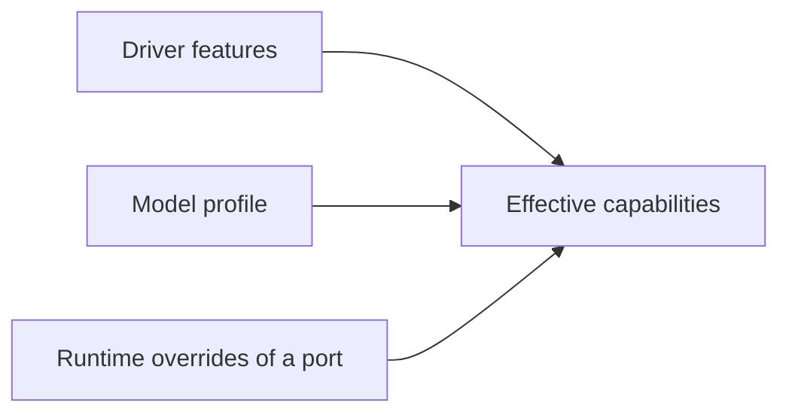

# Switch drivers

SwitchSteward talks to switches through **drivers**. Each driver supports one platform (an operating system family). It declares which features it supports, which hardware models it knows, and how it reads from and writes to the device. This page covers the driver architecture, the capability matrix, the model catalogs, the per-vendor details, and how to add a driver.

> **Status.** The Cisco IOS / IOS-XE driver is the reference driver. It has been used in production. **All other drivers are experimental and have not been validated against hardware.** Their commands and output parsers are based on vendor CLI/API documentation and synthetic device output. Test them on a lab device before you use them in production. In the UI they are marked "(experimental)".

Related documents: [installation.md](installation.md), [configuration.md](configuration.md), [authentication.md](authentication.md), [architecture.md](architecture.md), [wlan-catalyst-9800.md](wlan-catalyst-9800.md), [../SECURITY.md](../SECURITY.md), [../CHANGELOG.md](../CHANGELOG.md).

## Architecture

### Package layout

| Path | Purpose |
| --- | --- |
| `backend/app/switches/drivers/__init__.py` | Driver registry `DRIVERS` (a dict keyed by `driver.id`, built from a tuple of driver instances), `get_driver(device_type)`, `list_drivers()` (sorted by vendor, then label). |
| `backend/app/switches/drivers/base.py` | Abstract base `SwitchDriver` (all `read_*` and `plan_*` methods, `execute_plan`), `SshSwitchDriver` (Netmiko base with the generic `execute_plan`), `PortChange` (requested port settings), `WriteResult`, and shared row constructors (`empty_switchport_detail`, `empty_poe_detail`, `empty_poe_summary`, `neighbor_row`, `client_snapshot`). |
| `backend/app/switches/drivers/plans.py` | Change plans: step types (`CliLines`, `CliCommand`, `Pause`, `RestCall`), `ChangePlan` (displayed redacted `lines`, sent `steps`, `secrets`, risk/persistent/reloads flags), `combine_plans`, `redact`, `TransferLocation`, and the typed change requests of the security, device and firmware operations. |
| `backend/app/switches/drivers/cisco/` | Cisco driver (`driver.py`), parsers (`parsers.py`, `device_parsers.py`), PoE (`poe.py`), client sources (`client_sources.py`), device settings/firmware/diagnostics (`device.py`), link aggregation and spanning tree (`l2.py`), port security (`security.py`), VTP (`vtp.py`), model catalog (`models.py`). |
| `backend/app/switches/drivers/aruba_aoscx.py`, `aruba_aoscx_l2.py`, `aruba_aoscx_device.py`, `aruba_aoss.py`, `aruba_aoss_l2.py`, `aruba_aoss_device.py`, `aruba_models.py` | Aruba AOS-CX and AOS-S drivers, their layer-2/port-security helpers (`*_l2.py`) and device settings/firmware/diagnostics modules (`*_device.py`), plus both catalogs (`AOSCX_CATALOG`, `AOSS_CATALOG`). |
| `backend/app/switches/drivers/netgear.py`, `netgear_l2.py`, `netgear_device.py`, `netgear_models.py` | Netgear fully managed driver, its running-configuration/port-security/LAG/STP helpers, its device settings/firmware/diagnostics module and `NETGEAR_CATALOG`. |
| `backend/app/switches/drivers/mikrotik.py`, `mikrotik_device.py`, `mikrotik_models.py` | MikroTik RouterOS v7 REST driver, its device settings/firmware/diagnostics module and `MIKROTIK_CATALOG`. |
| `backend/app/switches/drivers/cli.py` | Helpers shared by the SSH drivers: `run_config_lines` (sends configuration lines one at a time and stops at the first rejected line), `error_lines`, `parse_fixed_table`, `parse_key_values`, `parse_multiline_field`, `expand_port_list`. |
| `backend/app/switches/features.py` | Feature IDs (`FEATURES`, `POE_FEATURES`), reason constants, `FeatureSupport`, `supported()` / `unsupported()`, and capability resolution (`resolve`, `for_switch`, `require`, `to_json`). |
| `backend/app/switches/catalog.py` | `ModelProfile`, `Catalog` (first-match lookup, duplicate-ID check), and the PoE standard IDs `POE_STANDARDS`. |
| `backend/app/switches/transport.py` | Device connections: `ssh_session` / `open_ssh` (Netmiko, host-key policy, privileged mode), `send_show`, `https_client` (httpx with Basic auth, TLS verification, no redirects, no environment proxies). |
| `backend/app/switches/validation.py` | Vendor-neutral validation of every value that ends up in a device command (`validate_vlan_id`, `parse_vlan_list`, `sanitize_description`, `validate_choice`). |
| `backend/app/switches/vlans.py` | Vendor-neutral VLAN tab rules: `validate_vlan_name`, `VlanConstraints`, protection reasons, port usage (`vlan_usage`), `delete_blocker`, `describe`, `success_message`, `verify`. Imports no drivers. |
| `backend/app/switches/errors.py` | `SwitchConnectionError` (HTTP 502), `InvalidInputError` (HTTP 400), `UnsupportedFeatureError` (HTTP 409 `incompatible`). |
| `backend/app/switches/service.py` | Facade used by the routes: chooses the driver, checks capabilities before a session is opened, coalesces reads, records detected models. |
| `backend/app/switches/routes.py` | HTTP API for switch operations. |

### Driver interface

A driver is a stateless, shared instance of a `SwitchDriver` subclass with these attributes:

| Attribute | Meaning |
| --- | --- |
| `id` | Value stored in `switches.device_type` (for example `cisco_ios`). |
| `vendor`, `label` | Shown in the vendor/platform selection. |
| `transport` | `"ssh"` or `"https"`. |
| `default_port` | `22` for `SshSwitchDriver`; `443` for MikroTik. When you pick a driver, the UI sets this port unless you already changed the port field. |
| `experimental` | `True` by default; only `CiscoDriver` sets it to `False`. |
| `features` | Mapping of feature ID to `FeatureSupport`. A feature missing from the mapping counts as unsupported ("not supported by the driver"). |
| `catalog` | `Catalog` of `ModelProfile` entries. |
| `max_vlan_id` | Highest VLAN ID the VLAN tab may create (default `4094`; Netgear `4093`). |

Reads: `session()`, `check_connection()`, `read_device_info()`, `read_interfaces()`, `read_vlans()`, `read_switchports()`, `read_poe_ports()`, `read_poe_budget()`, `read_port_detail()`, `read_port_state()`, `read_neighbors()`, `read_client_snapshot()`, `read_vlan_constraints()` and the readers of the other tabs (`read_port_security()`, `read_lags()`, `read_stp()`, `read_vtp()`, `read_device_config()`, `read_firmware()`, `read_counters()`, `read_transceivers()`, `read_environment()`, `read_log()`, `read_cable_test()`, `read_running_config()`, `read_startup_config()`, `read_management_path()`). Writes: every write is a `ChangePlan` built by a `plan_*` method (`plan_port_change()`, `plan_port_state()`, `plan_save_config()`, `plan_vlan_create()`, …) and sent unchanged by `execute_plan()`. Helpers: `validate_port_change()`, `runtime_overrides()`, `has_switchport()` (interfaces whose VLAN membership `read_switchports()` must report; default: physical ports) and the abstract name helpers `validate_interface()`, `interface_key()`, `is_physical_interface()`. Read and plan methods that a driver does not override raise `UnsupportedFeatureError`.

### VLAN tab

The VLAN tab (`GET /api/switches/{id}/vlans`; writes are the operations `vlan-create`, `vlan-rename`, `vlan-delete` and `vlan-voice` sent through `POST …/changes/preview` and `…/changes/apply`; audit actions `create-vlan`, `rename-vlan`, `delete-vlan`, `set-vlan-voice`) is split between the vendor-neutral module `switches/vlans.py`, the service and the drivers:

- `read_vlan_constraints(session)` returns `vlans.VlanConstraints`: protected VLANs (ID → German reason, for example the default VLAN), the VLAN IDs with a layer-3 interface (`None` when they could not be read) and an optional VLAN limit.
- `plan_vlan_create(session, vlan_id, name)`, `plan_vlan_rename(session, vlan_id, name)`, `plan_vlan_delete(session, vlan_id)` and `plan_vlan_voice(session, vlan_id, voice)` only build the command plan. A rejected command returns "The switch rejected the command: …"; the success text comes from `vlans.success_message(...)`.
- The service checks everything else before the first write: the name rule (1–32 characters from letters, digits, `.`, `_`, `-`, not only digits; the same for all vendors), `max_vlan_id`, whether the VLAN already exists or is missing, the VLAN limit, and the delete blockers. After an accepted write it reads the VLAN list again; a change that is not visible is reported as failed.
- A VLAN cannot be deleted when it is protected, when it has a layer-3 interface, when layer-3 interfaces could not be read, when a port uses it as access, native or voice VLAN or lists it explicitly in its allowed VLANs (every mode except access and routed, so Cisco DTP ports count), or when the VLAN configuration of a port could not be read (unparsable allowed list, or a port that carries VLAN membership (`has_switchport`: physical ports, plus Cisco port-channels and Netgear LAGs) from `read_interfaces` without switchport details, for example beyond a driver's 64-port read limit). Allowed lists of `all` (or 1–4094) do not count as using a VLAN.

### Effective capabilities

For a given switch, `features.resolve()` combines three sources:



1. **Driver.** `driver.features.get(feature)`. A missing entry becomes unsupported with reason `NOT_IMPLEMENTED_REASON` ("This function is not supported by the driver."). An unknown `device_type` makes every feature unsupported with `UNKNOWN_DRIVER_REASON`.
2. **Model profile.** The *detected* model (`switches.detected_model_id`) takes precedence over the *selected* model (`switches.model_id`). Unknown IDs count as "no profile".
   - `poe_standards == ()` (the model has no PoE): `poe`, `poe_mode`, `poe_limit` and `poe_budget` become unsupported with `NO_POE_MODEL_REASON` ("The model {model} has no PoE ports.").
   - No profile, or `poe_standards is None` (PoE depends on modules or line cards): only `poe_limit` is locked, with `UNKNOWN_MODEL_POE_REASON`.
   - `speeds` set on the profile: the `speed` options are reduced to that list. No catalog currently sets `speeds`.
3. **Runtime overrides.** `driver.runtime_overrides(detail)` returns `{feature_id: reason}` for a single port (for example "no PoE on this port", or "port not in a bridge"). These are applied in `get_interface_detail` and again when the port-configure operation builds its plan, after `read_port_state` and before the first write. They can only switch off features that are otherwise supported.

Every `FeatureSupport` carries `supported`, `reason` (a German message ID, translated on output), `options` (allowed values, for example speed values) and `requires` (coupled features: on most non-Cisco drivers, `speed` requires `duplex` and vice versa; `speed=auto` without a duplex is accepted).

Write requests are checked in `service.check_port_change()` before any session is opened. Each `PortChange` field maps to a feature (`description`→`port_description`, `mode`→`port_mode`, `access_vlan`, `native_vlan`, `trunk_allowed_vlans`, `edge_port`, `speed`, `duplex`, `shutdown`→`port_state`, `poe_mode`, `poe_standard`→`poe_limit`). An unsupported feature or an option that is not allowed raises `UnsupportedFeatureError`. The response is:

```json
HTTP 409
{"detail": {"message": "<translated reason>", "code": "incompatible", "feature": "<feature id>"}}
```

### How the UI shows "incompatible"

The frontend (`frontend/switches.js`) reads `capabilities` from the switch object and, for the port dialog, `capability_overrides` from the interface detail. Port overrides take precedence (`featureState()`). Unsupported features are rendered disabled with the CSS class `is-incompatible`, a tooltip "Incompatible: <reason>", and an `incompatible-badge` ("incompatible"). This applies to:

- **Tabs:** Interfaces ↔ `interfaces`, VLANs ↔ `vlans`, Summary ↔ `device_summary`, Neighbors ↔ `neighbors`, Clients ↔ `clients`. In the VLAN tab, "Create VLAN" ↔ `vlan_create`, "Rename" ↔ `vlan_rename`, "Delete" ↔ `vlan_delete`.
- **Buttons:** "Save config" ↔ `save_config`. Port on/off ↔ `port_state`. The PoE column ↔ `poe`. The summary PoE budget row ↔ `poe_budget`.
- **Port dialog:** each field maps to its feature. Options outside `options` / `port_options` are shown disabled with the suffix "(incompatible)".
- **Copy/paste between switches:** fields that are incompatible on the target are skipped and listed as "Not applied (incompatible): …".
- **Global client search:** switches without `client_search` are skipped and listed as "Not searched (incompatible): …" (`skipped_switches` in the response).

### Capability-related API

All routes are under `/api`. For roles, see [authentication.md](authentication.md).

| Method and path | Role | Content |
| --- | --- | --- |
| `GET /api/switch-drivers` | any signed-in user | Every driver: `id`, `vendor`, `label`, `transport`, `default_port`, `experimental`, `features` (the driver's declaration, without model/runtime restrictions), `models` (`id`, `label`). |
| `GET /api/switches/{id}/capabilities` | any signed-in user | Effective capabilities of the switch (driver ∩ model profile), as `{feature: {supported, reason, options, requires}}`. |
| `GET /api/switches/{id}/interface-detail?interface=…` | any signed-in user | Port detail including `capability_overrides` (runtime findings) and `port_options` (speed/duplex options valid for this port). |
| Switch objects from the inventory API | any signed-in user | Contain `driver` (`id`, `vendor`, `label`, `transport`, `experimental`), `model` (`selected_id`, `detected`, `detected_id`, `effective_label`) and `capabilities`. |

Device operations: `POST /api/switches/{id}/test-connection`, `GET …/interface-inventory`, `GET …/interface-detail`, `GET …/summary`, `GET …/client-inventory`, `GET …/neighbors`, `GET /api/clients/search?q=…` and the read routes of the other tabs (`…/backups`, `…/port-security`, `…/lags`, `…/stp`, `…/vtp`, `…/device-config`, `…/firmware`, `…/diagnostics/…`), plus `GET /api/vtp/domains` (VTP status of every switch with `vtp` support, grouped by domain, with problem hints). Every write goes through `POST …/changes/preview` (shows the exact commands, redacted) and `POST …/changes/apply` (sends exactly those commands); the operation kind decides the required role (admin or operator) and the audit action (see `docs/architecture.md`).

VTP lock: on a switch with `vtp` support, `vlan-create`, `vlan-rename` and `vlan-delete` (and the VLAN rollout) are refused in preview and apply while the switch is a VTP client or a VTPv3 server that is not the primary server; `GET …/vlans` returns the reason as `vtp: {reason, takeover}` (`null` when unlocked), `takeover` meaning operation `vtp-primary` lifts the lock. VTP version 1/2 servers and clients also refuse extended VLANs (1006–4094). The primary role is read only from `VTP Operating Mode : Primary Server`, never from Primary ID = Device ID.

Model detection: a successful connection test or summary read stores the model string the device reports and the matching catalog ID (`detected_model`, `detected_model_id`).

## Capability matrix

Values come from each driver's `features` declaration. Columns are in registration order of the `DRIVERS` tuple. Every driver declares every feature ID.

Legend: ✓ supported (with the allowed options) · ✗ unsupported, the number refers to the reason below · **M** can additionally be locked by the model profile (model without PoE; unknown model locks `poe_limit`). PoE features can also be locked per port at runtime ("This interface does not provide PoE."); MikroTik and AOS-S lock VLAN features per port at runtime (port outside a VLAN-filtering bridge, `Trk` member); MikroTik locks speed/duplex below RouterOS 7.12.

| Feature ID | `cisco_ios` | `cisco_xe` | `mikrotik_routeros` | `aruba_aoscx` | `aruba_osswitch` | `netgear_prosafe` |
| --- | --- | --- | --- | --- | --- | --- |
| `device_summary` | ✓ | ✓ | ✓ | ✓ | ✓ | ✓ |
| `poe_budget` | ✓ M | ✓ M | ✗ 1 | ✓ M | ✓ M | ✓ M |
| `interfaces` | ✓ | ✓ | ✓ | ✓ | ✓ | ✓ |
| `port_detail` | ✓ | ✓ | ✓ | ✓ | ✓ | ✓ |
| `port_description` | ✓ | ✓ | ✓ | ✓ | ✓ | ✓ |
| `port_mode` | ✓ `access,trunk` | ✓ `access,trunk` | ✓ `access,trunk` | ✓ `access,trunk` | ✓ `access,trunk` | ✓ `access,trunk` |
| `access_vlan` | ✓ | ✓ | ✓ | ✓ | ✓ | ✓ |
| `native_vlan` | ✓ | ✓ | ✓ | ✓ | ✓ | ✓ |
| `trunk_allowed_vlans` | ✓ | ✓ | ✓ | ✓ | ✓ | ✓ |
| `voice_vlan` | ✓ | ✓ | ✓ | ✓ | ✓ | ✓ |
| `vlans` | ✓ | ✓ | ✓ | ✓ | ✓ | ✓ |
| `vlan_create` | ✓ | ✓ | ✓ | ✓ | ✓ | ✓ |
| `vlan_rename` | ✓ | ✓ | ✓ | ✓ | ✓ | ✓ |
| `vlan_delete` | ✓ | ✓ | ✓ | ✓ | ✓ | ✓ |
| `vlan_voice` | ✗ 2 | ✗ 2 | ✗ 3 | ✓ | ✓ | ✗ 2 |
| `vtp` | ✓ `server,client,transparent,off` | ✓ `server,client,transparent,off` | ✗ 21 | ✗ 21 | ✗ 21 | ✗ 21 |
| `edge_port` | ✓ | ✓ | ✓ | ✓ | ✓ | ✓ |
| `speed` | ✓ `auto,10,100,1000` | ✓ `auto,10,100,1000` | ✓ `auto,10,100,1000` requires `duplex` | ✓ `auto,10,100,1000` requires `duplex` | ✓ `auto,10,100,1000` requires `duplex` | ✓ `auto,10,100,1000` requires `duplex` |
| `duplex` | ✓ `auto,half,full` | ✓ `auto,half,full` | ✓ `auto,half,full` requires `speed` | ✓ `auto,half,full` requires `speed` | ✓ `auto,half,full` requires `speed` | ✓ `auto,half,full` requires `speed` |
| `port_state` | ✓ | ✓ | ✓ | ✓ | ✓ | ✓ |
| `port_bounce` | ✓ | ✓ | ✓ | ✓ | ✓ | ✓ |
| `poe` | ✓ M | ✓ M | ✓ M | ✓ M | ✓ M | ✓ M |
| `poe_mode` | ✓ `auto,static,never` M | ✓ `auto,static,never` M | ✓ `auto,never` M | ✓ `auto,never` M | ✓ `auto,never` M | ✓ `auto,never` M |
| `poe_limit` | ✓ M | ✓ M | ✗ 4 | ✗ 5 | ✗ 6 | ✗ 7 |
| `poe_cycle` | ✓ M | ✓ M | ✓ M | ✓ M | ✓ M | ✓ M |
| `errdisable_recovery` | ✓ | ✓ | ✓ | ✓ | ✓ | ✓ |
| `neighbors` | ✓ | ✓ | ✓ | ✓ | ✓ | ✓ |
| `clients` | ✓ | ✓ | ✓ | ✓ | ✓ | ✓ |
| `client_search` | ✓ | ✓ | ✓ | ✓ | ✓ | ✓ |
| `save_config` | ✓ | ✓ | ✗ 8 | ✓ | ✓ | ✓ |
| `config_backup` | ✓ | ✓ | ✓ | ✓ | ✓ | ✓ |
| `config_compare` | ✓ | ✓ | ✗ 9 | ✓ | ✓ | ✓ |
| `config_restore` | ✓ | ✓ | ✗ 10 | ✓ | ✓ | ✓ |
| `config_rollback` | ✗ 11 | ✓ | ✗ 12 | ✓ | ✗ 12 | ✗ 12 |
| `management_path` | ✓ | ✓ | ✓ | ✓ | ✓ | ✓ |
| `port_security` | ✓ `protect,restrict,shutdown` | ✓ `protect,restrict,shutdown` | ✗ 13 | ✓ `restrict,shutdown` | ✓ `restrict,shutdown` | ✓ `protect,restrict,shutdown` |
| `port_security_sticky` | ✓ | ✓ | ✗ 13 | ✓ | ✓ | ✓ |
| `dot1x` | ✓ `dot1x,mab,dot1x_mab` | ✓ `dot1x,mab,dot1x_mab` | ✓ `dot1x,mab` | ✓ `dot1x,mab,dot1x_mab` | ✓ `dot1x,mab,dot1x_mab` | ✓ `dot1x,mab` |
| `dot1x_host_mode` | ✓ `single,multi_auth,multi_host,multi_domain` | ✓ `single,multi_auth,multi_host,multi_domain` | ✗ 14 | ✓ `single,multi_auth,multi_host,multi_domain` | ✓ `single,multi_auth,multi_host` | ✓ `single,multi_auth,multi_host` |
| `dot1x_fallback_vlans` | ✓ | ✓ | ✗ 14 | ✓ | ✓ | ✓ |
| `stp_guard` | ✓ `bpdu_guard,root_guard,loop_guard` | ✓ `bpdu_guard,root_guard,loop_guard` | ✓ `bpdu_guard,root_guard` | ✓ `bpdu_guard,root_guard,loop_guard` | ✓ `bpdu_guard,root_guard,loop_guard` | ✓ `root_guard,loop_guard` |
| `storm_control` | ✓ `broadcast,multicast` | ✓ `broadcast,multicast,unknown_unicast` | ✓ `broadcast,multicast,unknown_unicast` | ✓ `broadcast,multicast,unknown_unicast` | ✓ `broadcast,multicast,unknown_unicast` | ✓ `broadcast,multicast,unknown_unicast` |
| `storm_control_action` | ✓ `drop,shutdown` | ✓ `drop,shutdown` | ✓ `drop` | ✓ `drop` | ✓ `drop,shutdown` | ✓ `drop,shutdown` |
| `dhcp_snooping` | ✓ | ✓ | ✓ | ✓ | ✓ | ✓ |
| `arp_inspection` | ✓ | ✓ | ✗ 15 | ✓ | ✓ | ✓ |
| `ip_source_guard` | ✓ | ✓ | ✗ 16 | ✓ | ✓ | ✓ |
| `lag` | ✓ `static,lacp_active,lacp_passive` | ✓ `static,lacp_active,lacp_passive` | ✓ `static,lacp_active` | ✓ `static,lacp_active,lacp_passive` | ✓ `static,lacp_active,lacp_passive` | ✓ `static,lacp_active,lacp_passive` |
| `stp` | ✓ `pvst,rapid_pvst,mstp` | ✓ `pvst,rapid_pvst,mstp` | ✓ `stp,rstp,mstp` | ✓ `rapid_pvst,mstp` | ✓ `rapid_pvst,mstp` | ✓ `stp,rstp,mstp` |
| `stp_mst` | ✓ | ✓ | ✓ | ✓ | ✓ | ✓ |
| `device_identity` | ✓ | ✓ | ✓ | ✓ | ✓ | ✓ |
| `device_services` | ✓ | ✓ | ✓ | ✓ | ✓ | ✓ |
| `device_snmp` | ✓ | ✓ | ✓ | ✓ | ✓ | ✓ |
| `device_aaa` | ✓ `radius,tacacs,login_order` | ✓ `radius,tacacs,login_order` | ✓ `radius` | ✓ `radius,tacacs,login_order` | ✓ `radius,tacacs,login_order` | ✓ `radius,tacacs,login_order` |
| `device_users` | ✓ | ✓ | ✓ | ✓ | ✓ | ✓ |
| `device_ssh` | ✓ `timeout,telnet,web` | ✓ `timeout,telnet,web` | ✓ `telnet,web` | ✓ `timeout,web` | ✓ `timeout,telnet,web` | ✓ `timeout,telnet,web` |
| `device_l3` | ✓ `svi,gateway,dhcp_relay,static_routes` | ✓ `svi,gateway,dhcp_relay,static_routes` | ✓ `svi,gateway,dhcp_relay,static_routes` | ✓ `svi,gateway,dhcp_relay,static_routes` | ✓ `svi,gateway,dhcp_relay,static_routes` | ✓ `svi,gateway,dhcp_relay,static_routes` |
| `acl` | ✓ `port_in,port_out,vlan_in,vlan_out` | ✓ `port_in,port_out,vlan_in,vlan_out` | ✓ `port_in,vlan_in,vlan_out` | ✓ `port_in,port_out,vlan_in,vlan_out` | ✓ `port_in,port_out,vlan_in,vlan_out` | ✓ `port_in,port_out,vlan_in,vlan_out` |
| `qos` | ✓ `none,cos,dscp` | ✓ `none,cos,dscp` | ✓ `none,cos,dscp` | ✓ `none,cos,dscp` | ✗ 17 | ✓ `none,cos,dscp` |
| `qos_voice` | ✓ | ✓ | ✗ 18 | ✓ | ✗ 17 | ✓ |
| `firmware` | ✓ | ✓ | ✓ | ✓ | ✓ | ✓ |
| `reload` | ✓ | ✓ | ✓ | ✓ | ✓ | ✓ |
| `diag_counters` | ✓ | ✓ | ✓ | ✓ ¹⁹ | ✓ | ✓ |
| `diag_transceivers` | ✓ | ✓ | ✓ | ✓ | ✓ | ✓ |
| `cable_test` | ✓ | ✓ | ✗ 20 | ✓ | ✓ | ✓ |
| `device_log` | ✓ | ✓ | ✓ | ✓ | ✓ | ✓ |
| `environment` | ✓ | ✓ | ✓ | ✓ | ✓ | ✓ |

Reasons:

1. RouterOS does not report a total PoE budget.
2. On this platform the voice VLAN is a port setting.
3. RouterOS has no voice VLAN object.
4. PoE power profiles are not supported for RouterOS.
5. AOS-CX offers no per-port PoE power limit in watts.
6. PoE power profiles are not supported for AOS-S.
7. The Netgear driver does not set PoE power profiles.
8. RouterOS applies changes permanently right away.
9. RouterOS has no startup configuration.
10. A RouterOS export contains no certificate keys; after the reset the REST API would be unreachable.
11. Timed rollback is not reliably available on IOS 15.2.
12. The platform has no timed rollback.
13. CRS3xx has no per-port MAC limit.
14. RouterOS has no 802.1X host modes or fallback VLANs.
15. RouterOS has no Dynamic ARP Inspection.
16. RouterOS has no IP Source Guard.
17. AOS-S has no per-port QoS trust setting.
18. RouterOS offers no per-port voice QoS preset.
19. AOS-CX: counters can be read but not reset ("AOS-CX offers no way to reset the port counters.").
20. CRS3xx does not support a cable test.
21. VTP is a Cisco protocol and is not supported by this switch type.

All drivers except Cisco are `experimental`; their commands were verified against simulated devices only. File transfers (restore, firmware): Cisco and MikroTik download via HTTP(S) from `/transfer/…`; AOS-CX, AOS-S and Netgear via the built-in read-only SFTP server (AOS-S and Netgear only from port 22).

Speed/duplex rules for drivers with coupled speed and duplex: `speed=auto` requires duplex `auto` or none; a fixed speed requires `half` or `full`; `1000` + `half` is rejected (HTTP 400). On Cisco, the speed/duplex options shown in the port dialog are further narrowed to what `show interfaces <if> capabilities` reports.

## Model catalogs

A catalog is a tuple of `ModelProfile(id, vendor, label, match, poe_standards, poe_ports=None, speeds=None, notes=None)`. `Catalog.match()` returns the **first** profile whose regular expression matches the model string the device reports. That is why PoE variants are listed before the plain model. Model IDs are unique within a catalog. You can pick a model in the switch dialog ("Detect automatically" = none); a detected model overrides your choice.

PoE standard IDs (`catalog.POE_STANDARDS`): `802.3af`, `802.3at`, `802.3bt-type3`, `802.3bt-type4`, `cisco-upoe`.

| Driver | Catalog | Model string source | Profiles |
| --- | --- | --- | --- |
| `cisco_ios`, `cisco_xe` | `drivers/cisco/models.py` `CATALOG` (30 profiles) | PID from `show version` (full match, `WS-` prefix optional) | PoE profiles: Catalyst 2960-X/-XR/-S/-L PoE+, 3560-X/3750-X PoE+ and UPOE, 3560 PoE, 3750 PoE, 3650 PoE+ and UPOE, 3850 PoE+ and UPOE, 9200 / 9200L PoE+, 9300 / 9300L PoE+, 9300 / 9300X 802.3bt, 9300 / 9300B / 9300L UPOE. Non-PoE profiles: 2960-X, 2960-XR, 3650, 3850, 9200, 9200L, 9300, 9300L, 9300X. This is a conservative allowlist of documented hardware PIDs; an unknown PID means "no profile". |
| `aruba_aoscx` | `AOSCX_CATALOG` in `drivers/aruba_models.py` (20 profiles) | "Product Name" from `show system` | Families 6000, 6100, 6200F, 6300M, 6300F, each with a Class 6 profile (`aoscx-<family>-cl6`: 802.3af/at/bt-type3), a PoE profile (`aoscx-<family>-poe`, matched by CL4/Class 4/PoE: 802.3af/at) and a non-PoE profile. 8100, 8320, 8325, 8360 without PoE. `aoscx-6400` (6405/6410 chassis) with `poe_standards=None` (PoE depends on line cards). |
| `aruba_osswitch` | `AOSS_CATALOG` in `drivers/aruba_models.py` (18 profiles) | Chassis line from `show modules`, otherwise from `show system` | 2530, 2540, 2930F: PoE+ (`-poep`: af/at), PoE (`-poe`: af), no PoE. 2930M, 3810M: additionally Class 6 (`-cl6`: af/at/bt-type3). `aoss-5400r` (5406R/5412R chassis) with `poe_standards=None`. |
| `netgear_prosafe` | `NETGEAR_CATALOG` in `drivers/netgear_models.py` (17 profiles) | Marketing name (e.g. `M4250-26G4F-PoE+`) from `show version` | M4250, M4300, M4350, M5300, each with: UP (`UP90` or `-UP`: af/at/bt-type4), PoE++ (af/at/bt-type3), PoE+ (af/at), no PoE. M7100 has no PoE. Part numbers such as `GSM…` are not matched (unknown model). |
| `mikrotik_routeros` | `MIKROTIK_CATALOG` in `drivers/mikrotik_models.py` (8 profiles) | `/system/routerboard` `model`, otherwise `/system/resource` `board-name` | CRS1xx, CRS2xx, CRS3xx, CRS5xx, each with a PoE profile (name pattern `-<n>P-`, e.g. `CRS328-24P-4S+`: 802.3af/at) and a non-PoE profile. |

All non-Cisco PoE classifications are derived from vendor product naming and **have not been verified on hardware**. The PoE budget shows the catalog standards with the source "Vendor naming (not verified on hardware): <model>".

Default ports: 22 (SSH) for every Netmiko driver, 443 (HTTPS) for `mikrotik_routeros`.

## Per-vendor details

Shared behavior of the SSH drivers:

- Netmiko connection parameters come from `transport.netmiko_params`: host-key checking (`ssh.strict_host_keys`, `ssh.known_hosts_file`), timeout `ssh.timeout_seconds` (also used as the read timeout), and `ssh-rsa` disabled unless `ssh.allow_legacy_algorithms` is set. See [configuration.md](configuration.md).
- Configuration lines are sent one at a time through `cli.run_config_lines`. The sequence stops at the first line the switch rejects (detected with per-driver error markers), and the result reports the rejected line.
- Every value put into a command goes through `validation.py`. Descriptions with control characters are rejected.
- **Port writes never create VLANs.** If a target VLAN does not exist, the request is rejected with "VLAN {vlan} does not exist on the switch." before the first write. This applies to all non-Cisco drivers. VLANs are only created, renamed and deleted through the VLAN tab (see [VLAN tab](#vlan-tab)).
- A save uses a read timeout of at least 100 s (`SAVE_CONFIG_MIN_TIMEOUT_SECONDS`).
- After a read timeout, the session is marked broken and optional reads are skipped, with a warning.

### Cisco IOS / IOS-XE (`cisco_ios`, `cisco_xe`)

- **Status:** reference driver, production-tested, `experimental = False`. One class, `CiscoDriver`, registered twice.
- **Netmiko device type:** the same as the driver ID (`cisco_ios` or `cisco_xe`).
- **Prerequisites:** SSH enabled; an account with privilege 15, or an enable secret stored with the credentials (the driver enters privileged mode only if the session is not already privileged). Old IOS releases that only offer SHA-1 key exchange or `ssh-rsa` host keys need `ssh.allow_legacy_algorithms` (trusted networks only; see [../SECURITY.md](../SECURITY.md)).
- **Read commands:** `show version`, `show interfaces status`, `show vlan brief`, `show interfaces switchport` (bulk, with per-port fallback `show interfaces <if> switchport` for up to 64 ports), `show power inline`, `show running-config interface <if>`, `show interfaces <if> capabilities`, `show cdp neighbors detail`, `show lldp neighbors detail`, `show ip interface brief` (VLAN tab: `Vlan<N>` SVIs block deleting; unsupported syntax counts as "no layer-3 interfaces", other errors block every deletion). Client inventory: `show mac address-table` (fallback `show mac-address-table`), `show port-security address`, `show authentication sessions` (fallback `show access-session`), `show ip arp`, `show device-tracking database`, `show ip device tracking all`, `show ip dhcp snooping binding` (the last three only while IP addresses are still missing).
- **Write commands** (under `interface <if>`): `description …` / `no description`, `switchport mode access`, `switchport trunk encapsulation dot1q` (tolerated where unsupported) + `switchport mode trunk`, `switchport access vlan N`, `switchport trunk native vlan N`, `switchport trunk allowed vlan <list>` (long lists continue with `switchport trunk allowed vlan add …`), `speed …`, `duplex …`, `spanning-tree portfast` / `spanning-tree portfast trunk` (with `no` to remove), `power inline <auto|static|never> [max <mW>]` (sent first, after a fresh `show power inline` hardware check), `shutdown` / `no shutdown` (last). Save: Netmiko `save_config()` (`write memory`).
- **VLAN tab commands:** create `vlan N` (+ `name X`), rename `vlan N`, `name X`, delete `no vlan N`. VLAN 1 (default) and 1002–1005 (reserved) are protected. In VTP client mode, or for extended-range VLANs with VTP v1/v2, IOS rejects the change and the device message is shown.
- **Error detection:** `%` error lines; for `power inline`, also `Command rejected:` / `Error:` lines.

### Aruba AOS-CX (`aruba_aoscx`)

- **Status:** experimental, not validated against hardware.
- **Netmiko device type:** `aruba_aoscx`. Sessions open **without** an enable step (`privileged=False`); AOS-CX has no enable mode.
- **Prerequisites:** SSH login with an administrator role (prompt `#`). Operator accounts (`>`) can read but cannot configure. No enable secret is needed. Port writes need existing VLANs.
- **Read commands:** `show system`, `show version`, `show interface brief`, `show vlan`, `show running-config`, `show running-config interface <if>`, `show interface <if>`, `show power-over-ethernet brief`, `show power-over-ethernet`, `show lldp neighbor-info detail` (fallback `show lldp neighbor-info`), `show mac-address-table`, `show arp all-vrfs` (fallback `show arp`).
- **Write commands:** `interface <if>` (LAG as `interface lag N`), `description …` / `no description` (max. 64 characters), `power-over-ethernet` / `no power-over-ethernet`, `no routing` (sent before VLAN commands unless the port's configuration already shows `no routing`), `vlan access N`, `no vlan trunk native`, `vlan trunk native N`, `vlan trunk allowed <list>` / `vlan trunk allowed all`, `no vlan trunk allowed [<list>]`, `spanning-tree port-type admin-edge` / `no spanning-tree port-type`, `speed auto` / `speed <10|100|1000>-<half|full>`, `shutdown` / `no shutdown` (last). Save: `write memory` (`conn.save_config(cmd="write memory")`, because Netmiko's default would be `copy running-config startup-config`).
- **Behavior:** changes to the allowed VLAN list send only the difference (`vlan trunk allowed` adds to the list). The list is replaced completely only when it is currently `all` or cannot be read. A mode change requires the VLAN for the new mode: access needs `access_vlan`, trunk needs `native_vlan`.
- **VLAN tab commands:** create `vlan N` (+ `name X`), rename `vlan N`, `name X`, delete `no vlan N`. VLAN 1 (default) is protected; `interface vlanN` blocks in a fresh `show running-config` count as layer-3 interfaces.
- **Error markers:** lines starting with `% `, `Invalid input`, `Command incomplete`, `Ambiguous command`, `does not exist`, `not allowed`, `Error` (the echoed command is ignored).
- **Interface names:** `<member>/<slot>/<port>` and `lag N`.

### Aruba AOS-S (`aruba_osswitch`)

- **Status:** experimental, not validated against hardware.
- **Netmiko device type:** `aruba_osswitch`. It exists in Netmiko 4.7.0 (mapped to the ProCurve class, like `aruba_procurve`).
- **Prerequisites:** SSH enabled. Netmiko runs `enable` while opening the session, and that step must succeed: log in with a manager-level account, or store the manager password as the **enable secret**. If enable fails, the error is "Manager mode (enable) could not be entered. Check the enable credentials." Configuration mode is `configure terminal`.
- **Read commands:** `show system`, `show modules`, `show interfaces brief`, `show running-config` (VLAN membership, `interface … name`, `speed-duplex`, `disable`, `spanning-tree … admin-edge-port`; read fresh before every write), `show vlans`, `show power-over-ethernet brief`, `show power-over-ethernet`, `show lldp info remote-device` plus `show lldp info remote-device <port>` (max. 64 ports), `show mac-address vlan <id>` (max. 64 VLANs), `show arp`.
- **Write commands** (global configuration context): `interface <p> name "<text>"` / `no interface <p> name` (max. 64 characters, no double quotes), `vlan N untagged <p>`, `vlan N tagged <p>`, `no vlan N tagged <p>`, `spanning-tree <p> admin-edge-port` / `no spanning-tree <p> admin-edge-port`, `interface <p> speed-duplex auto|10-half|10-full|100-half|100-full|1000-full`, `interface <p> power-over-ethernet` / `no interface <p> power-over-ethernet`, `interface <p> enable|disable` (last). The keyword `trunk` (link aggregation on AOS-S) is never sent. Save: Netmiko `save_config()` (`write memory`).
- **Mapping:** trunk = tagged in at least one VLAN; native = the untagged VLAN; access = untagged only. `trunk_allowed_vlans=all` means all existing VLANs. There is no request value for "no native VLAN", so `no vlan N untagged` is never sent.
- **VLAN tab commands:** create `vlan N name "X"` (or `vlan N`), rename `vlan N name "X"`, delete `no vlan N`. VLAN 1, the primary VLAN and the management VLAN (header of `show vlans`) are protected; VLAN blocks with `ip address …` or `ipv6 …` in the running configuration count as layer-3 interfaces; `Maximum VLANs to support` limits creation.
- **Error markers:** `Invalid input`, `Ambiguous input`, `Incomplete input`, `Module not present`, `not found`, `not valid`, `Error`.
- **Limitations:** the MAC table is read per VLAN and capped at 64 VLANs; port security and 802.1X sessions are not read; `show name` is not used (descriptions come from the running configuration).

### Netgear fully managed (`netgear_prosafe`)

- **Status:** experimental, not validated against hardware. Label: "Netgear M4250/M4300/M4350/M5300/M7100".
- **Netmiko device type:** `netgear_prosafe`. Netmiko sends `enable` and `terminal length 0`; configuration mode is `configure`. Netmiko only recognizes the `(Config)#` prompt, so every interface sequence ends with an explicit `exit`.
- **Prerequisites:** CLI management enabled (not Insight/cloud mode). SSH is often **off by default**; enable it via console, Telnet or the web UI (`crypto key generate rsa`, then `ip ssh server enable` in `configure`). The enable password is usually empty. `show arp` usually needs routing enabled; without it, client IP addresses are missing and a warning is shown.
- **VLAN syntax detection:** once per session, the driver runs `show interfaces switchport <port>`. If it succeeds, the `switchport …` syntax is used. If the firmware rejects it (`Invalid input`, `Command not found`, `Unrecognized command`), the classic syntax is used (`vlan participation` / `vlan tagging` / `vlan pvid`), and membership is derived from the running configuration.
- **Read commands:** `show version`, `show sysinfo`, `show interfaces status all`, `show port all`, `show vlan brief`, `show interfaces switchport <p>` (per port and LAG, max. 64) or `show running-config` (classic), `show running-config interface <p>`, `show vlan port <p>`, `show poe port info all`, `show poe`, `show lldp remote-device all`, `show lldp remote-device detail <p>` (max. 64), `show mac-addr-table`, `show arp`.
- **Write commands** (`interface <p>` … `exit`): `poe` / `no poe`, `description "<text>"` / `no description` (max. 64 characters, no double quotes). Switchport syntax: `switchport mode access|trunk`, `switchport access vlan N`, `switchport trunk native vlan N`, `switchport trunk allowed vlan <list>|all`, `switchport trunk allowed vlan add …`, `switchport trunk allowed vlan remove …`. Classic syntax: `vlan participation include|exclude …`, `vlan tagging …` / `no vlan tagging N`, `vlan pvid N`. Then `speed auto` / `speed <10|100|1000> <half|full>-duplex`, `spanning-tree edgeport` / `no spanning-tree edgeport`, `shutdown` / `no shutdown`. Save: Netmiko `save_config()` (`write memory confirm`); it counts as successful only if the output contains `created successfully` or `Configuration Saved`.
- **VLAN tab commands** (Privileged EXEC sub-mode `vlan database`, left with `exit` only while the prompt shows `(Vlan)`): create `vlan N` (+ `vlan name N "X"`), rename `vlan name N "X"`, delete `no vlan N`. VLAN IDs 1–4093; VLAN 1 is protected; `vlan N` rows in `show interfaces status all` count as layer-3 interfaces. The VLAN membership of LAGs (`lag N` / `0/3/N`) is read like that of physical ports (`show interfaces switchport lag N`, or the `interface lag N` / `interface 0/3/N` block of the running configuration in the classic syntax), so a VLAN used only by a LAG blocks deletion.
- **Error markers** (anchored at line start): `% Invalid input`, `Invalid input`, `Command not found`, `Incomplete command`, `An invalid interface`, `Error`, `Failed`.
- **Interface names:** `u/s/p` (e.g. `1/0/1`) and `lag N`.
- **Further port-side features** (helper module `netgear_l2.py`): voice VLAN per port (`voice vlan N`, global `voice vlan` added when the running configuration lacks it; classic syntax also tags the voice VLAN, and a port whose only tagged VLAN is its voice VLAN reads as access port); port restart (`shutdown`, 5 s, `no shutdown`); PoE restart `poe reset`; err-disabled reasons from `show interfaces status err-disabled` (missing on M5300/M7100 11.0: no reasons, no recovery), recovery `no shutdown`; backups from `show running-config` / `show startup-config` (volatile: `!System Up Time`, `!Current SNTP Synchronized Time`); restore `copy sftp://… nvram:startup-config` (SFTP from port 22 only, file name ≤ 31 characters) followed by `reload` with the save question answered `n`. Port security, DHCP snooping/DAI/IPSG, storm control (`storm-control broadcast|multicast|unicast level N`, action `shutdown`) and root/loop guard (BPDU guard exists only globally and is not offered). 802.1X: M4250/M4350 use the authentication manager (`authentication port-control`, `mab`, `authentication host-mode`, `authentication event … action authorize vlan N`), M4300/M5300/M7100 the legacy commands (`dot1x port-control auto|mac-based|force-authorized`, `dot1x mac-auth-bypass`, `dot1x max-users`, `dot1x guest-vlan`, `dot1x unauthenticated-vlan`; multi-host only without MAB); the family follows the model from `show version`. LAGs `lag N` (1–64) are read from the running configuration (`addport`, `port-channel static`, LACP passive members) plus `show port-channel lag N`; M4250/M4350 create them with `port-channel lag N chN`, M5300/M7100 LAGs default to static. Spanning tree: modes `stp`, `rstp`, `mst`, priorities `spanning-tree mst priority <inst> <prio>` (0 = CIST), region and at most 4 MST instances, port cost/priority `spanning-tree mst <inst> cost|port-priority`.
- **Limitations:** `poe_limit` is declared unsupported. A port in general mode (several untagged VLANs) needs an explicit mode for VLAN changes. The interface inventory leaves the per-port PoE admin mode empty; the port detail derives it from `no poe` in the running configuration. In the switchport syntax the voice VLAN is only the `voice vlan N` port line (no tagged membership is added).

### MikroTik RouterOS v7 (`mikrotik_routeros`)

- **Status:** experimental, not validated against hardware.
- **Transport:** REST over HTTPS (`https://<ip>:<port>/rest`, default port 443) with Basic auth via `transport.https_client`. Netmiko is not used. TLS is verified against the system CAs or `switch_api.ca_cert_file`, with hostname checking against the switch address; `switch_api.allow_unverified_tls` disables verification. Timeout: `switch_api.timeout_seconds`. Redirects are not followed and responses over 10 MiB are rejected. The enable secret is ignored.
- **Prerequisites:**
  - RouterOS **v7** with the REST API reachable over HTTPS: the `www-ssl` service enabled with a certificate. The certificate must validate for the address entered in SwitchSteward (or use a CA file). Plain `www` (HTTP) is not supported by the driver.
  - A RouterOS user whose group grants read access, plus write access for changes. HTTP 403 is reported as "The REST user lacks permission for {path}." Check the RouterOS REST API documentation for the policies your version requires.
  - VLAN features need the port in a bridge with `vlan-filtering=yes`.
  - Speed/duplex need RouterOS 7.12 or newer.
- **REST calls:**

  | Method | Path | Use |
  | --- | --- | --- |
  | GET | `/system/resource`, `/system/identity`, `/system/routerboard` | Device info, version, model (`/system/routerboard` may be missing) |
  | GET | `/interface/ethernet` | Ports, comment, disabled/running, speed |
  | GET | `/interface/bridge`, `/interface/bridge/port`, `/interface/bridge/vlan` | VLAN filtering, pvid, frame types, edge, VLAN membership |
  | GET | `/interface/ethernet/poe` | PoE ports (400/404 = no PoE) |
  | POST | `/interface/ethernet/poe/monitor`, `/interface/ethernet/monitor` | PoE power, link rate/duplex (`{"numbers": …, "once": ""}`) |
  | GET | `/interface/bridge/host`, `/ip/arp`, `/ip/neighbor` | Clients, IP addresses, neighbors |
  | PATCH | `/interface/ethernet/{id}` | `comment`, `auto-negotiation`, `speed` (`10M-baseT-half` … `1G-baseT-full`), `disabled` |
  | PATCH | `/interface/bridge/port/{id}` | `frame-types`, `pvid`, `edge` |
  | PATCH | `/interface/bridge/vlan/{id}` | `tagged`, `untagged` |
  | PUT | `/interface/bridge/vlan` | Single-VLAN entry, only if the VLAN already exists in another entry of the same bridge; VLAN tab: new entry with `bridge`, `vlan-ids`, `comment` |
  | DELETE | `/interface/bridge/vlan/{id}` | VLAN tab: delete a single-VLAN entry (entries covering several VLANs are shortened via PATCH `vlan-ids`) |
  | GET | `/interface/vlan` | VLAN tab: VLAN interfaces on a bridge count as layer-3 interfaces |
  | PATCH | `/interface/ethernet/poe/{id}` | `poe-out` = `auto-on` or `off` (`forced-on` is never sent) |

- **Mapping:** access = `frame-types=admit-only-untagged-and-priority-tagged` with `pvid`. Trunk = `admit-only-vlan-tagged` (no native VLAN) or `admit-all` with tagged memberships (native = `pvid`). Allowed VLANs = bridge VLAN entries whose `tagged` list contains the port.
- **Behavior:** every change is planned and validated before the first write. A bridge VLAN entry that covers several VLANs and would only partly change is rejected with "The VLAN entry {ids} covers several VLANs; please split it on the device." Writes run in this order: Ethernet settings, VLAN entries, bridge port, PoE, `disabled` (last). They stop at the first rejected request. Only Ethernet interfaces can be edited.
- **VLAN tab:** the VLAN name is the `comment` of the first static single-VLAN bridge entry. Create needs exactly one bridge with `vlan-filtering=yes`; rename needs exactly one own static single-VLAN entry. VLANs that only exist dynamically (PVID or VLAN interface) are protected. Changes are permanent immediately.
- **Warning:** RouterOS applies every change permanently right away, and there is no save step. A VLAN change on the port or bridge carrying your management traffic can cut off access to the switch.
- **Limitations:** no PoE budget, no PoE watt limit, no voice VLAN object (the voice VLAN is a tagged port membership).

### Unverified assumptions (all experimental drivers)

The device output the experimental drivers were developed against is synthetic and was derived from vendor documentation. Among other things, these have not been confirmed on devices: column headers of status, PoE, LLDP and MAC tables; the AOS-CX defaults (access/native VLAN 1 when no line is configured); the Netgear classic-syntax defaults; the AOS-S behavior of `vlan N untagged` converting a tagged membership; and RouterOS boolean and PoE power formats. Please report deviations in a GitHub issue.

## Unsupported product lines

These lines are deliberately **not** offered as drivers, because they have no CLI or API that this tool could use reliably:

| Product line | Reason |
| --- | --- |
| Netgear Plus (GS1xxE, GS3xxE), Smart Managed Pro (GS7xxT/TP, GS110TP, GS3xxTP, MS510TX/TXPP), Insight-managed models, unmanaged GS1xx | No SSH CLI; managed via web UI or Netgear Insight only. Fully managed models in Insight/cloud mode also lose CLI management. |
| MikroTik CSS with SwOS (including dual-boot CRS models booted into SwOS) | SwOS has only a web UI and no CLI or REST API. Netmiko's `mikrotik_switchos` type does not change that. Use RouterOS v7 instead. |
| Aruba Instant On | Managed through the Instant On cloud/app or a local web UI; no CLI or API is offered that this tool supports. |
| Aruba wireless controllers (Netmiko `aruba_os`) | Not a switch platform. `aruba_os` is rejected as an unknown device type. |

## Adding a driver

1. **Create the module** `backend/app/switches/drivers/<name>.py`:
   - SSH/Netmiko: subclass `SshSwitchDriver` and set `id`, `vendor`, `label`, `netmiko_device_type`, `experimental = True`, `features`, `catalog`. Override `session()` if the platform has no enable mode (`transport.ssh_session(..., privileged=False)`, as in AOS-CX).
   - HTTPS/REST: subclass `SwitchDriver` and set `transport = "https"` and `default_port = 443`. Implement `session()` with `transport.https_client(...)`; the yielded session object must have a `warnings` list. Accept an optional `httpx.BaseTransport` so tests can inject one, as `MikrotikDriver(http_transport=...)` does.
   - Implement `validate_interface`, `interface_key` and `is_physical_interface`, plus every read/write method behind a supported feature. Return rows in the formats documented in `drivers/base.py`.
2. **Declare features** as a `FEATURES` dict over the IDs in `features.FEATURES`: `supported(options, requires=...)` or `unsupported(REASON)`. A missing ID means "not supported by the driver". Reasons are German message IDs.
3. **Implement runtime overrides** (`runtime_overrides(detail)`) for port-level restrictions, and make `read_port_state()` return the keys that `runtime_overrides` checks before a write.
4. **Validate every value** that goes into a command with `switches/validation.py` (VLAN names with `vlans.validate_vlan_name`). Send configuration through `cli.run_config_lines` with driver-specific error markers. Port writes never create VLANs; reject missing VLANs before the first write. VLANs are created, renamed and deleted only by the `plan_vlan_*` methods (VLAN tab).
5. **Add a catalog** (`<vendor>_models.py`) with `Catalog((ModelProfile(...), ...))`: unique IDs, PoE variants before the plain profile, `poe_standards=()` for no PoE, `None` when PoE depends on modules. Use IDs from `catalog.POE_STANDARDS`.
6. **Register the driver** by adding an instance to the tuple in `drivers/__init__.py`. `/api/switch-drivers`, the vendor/platform/model selection, and `device_type` validation of the inventory API pick it up automatically.
7. **Translate:** add English entries for every new German message (reasons, errors, warnings) to `MESSAGES` in `backend/app/i18n_en.py`. If you add frontend text, add it to `frontend/i18n.en.js`. Reuse existing message IDs where the text is the same.
8. **Test:** verify parsers and command sequences against recorded or synthetic device output and on a lab device; keep `experimental = True` until the driver is validated on hardware.
9. **Release:** nothing to register. `scripts/build_release.py` includes every `backend/app/**/*.py` (it skips `__pycache__` and dot-folders); `backend/app/release_manifest.py` only lists required files and patterns.
10. **Document:** add the driver to this page (capability matrix, catalog, vendor section) and to [../CHANGELOG.md](../CHANGELOG.md).
