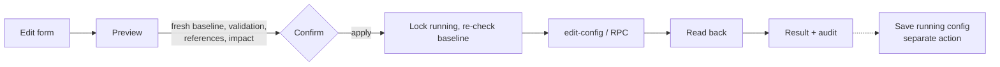

# WLAN: Cisco Catalyst 9800 wireless controllers

SwitchSteward has a dedicated **WLAN** workspace for Cisco Catalyst 9800
wireless LAN controllers (WLCs). It shows the access points (APs) and clients
registered on a controller and, over NETCONF, configures WLANs, profiles, tags
and individual APs with a preview/confirm workflow.

Configuration keys are described in [configuration.md](configuration.md#wireless); the
overall module layout is in [architecture.md](architecture.md).

## Scope

| Area | Status |
| --- | --- |
| Controller family | Cisco Catalyst 9800 (platform ID `catalyst_9800`). Other families (e.g. AireOS) are not supported; the adapter interface (`backend/app/wlan/adapters/base.py`) allows adding them. |
| Software | Built against the Cisco IOS XE 17.12 YANG models (published model set `17121`). The models the controller actually offers are checked at runtime. |
| Transports | RESTCONF (HTTPS, default port 443) for monitoring only; NETCONF over SSH (default port 830) for monitoring **and** configuration. The port is selectable per controller. |
| Reference environment | The adapters were developed and checked read-only against a Catalyst 9800 running IOS XE 17.12. Configuration changes were tested only with simulated device responses (see [Limits](#limits)). |

## Feature overview

- Controller inventory (name, host, transport, port, platform, location, note)
  with global or controller-specific device credentials.
- Connection test: transport, login, YANG library and the operational
  collections required for monitoring, using the stored service account.
- Overview with model, software version, offered capabilities and the
  save status tracked by this application (NETCONF).
- Access point list with server-side search, status filter and pagination;
  AP details with location, policy/site/RF tag, uptime, separate radio and
  Ethernet MAC addresses, and radios (band, channel, width, state, clients).
- Client list with server-side search, AP filter, SSID filter and pagination.
- Tabs **WLANs** and **Profiles & Tags** (NETCONF) reading the running
  configuration.
- Configuration editors for WLANs, policy/site/RF tags, policy/RF/AP join/
  FlexConnect profiles, and AP/radio actions (see
  [Configuration scope](#configuration-scope)).

AP and client data are live snapshots cached briefly in memory
(`wireless.cache_ttl_seconds`, default 30 s). They are not stored in SQLite, so
there is no history of AP availability or of disconnected clients.

## Controller prerequisites

1. Enable the selected transport on the controller: HTTPS/RESTCONF or
   NETCONF-YANG over SSH (NETCONF default port 830).
2. Create a dedicated service account.
   - Monitoring needs read access via NACM / API RBAC.
   - The configuration overviews additionally need `get-config` and
     `get-schema`.
   - Device changes need targeted rights for the offered configuration models,
     the AP RPCs and the save RPC (`cisco-ia:save-config`).
3. Make the controller's identity verifiable:
   - RESTCONF: the TLS certificate must validate. Use
     `wireless.restconf_ca_cert_file` for a private CA. Only for lab use,
     `wireless.allow_unverified_restconf_tls` disables verification.
   - NETCONF: strict host-key checking is on by default
     (`wireless.netconf_strict_host_keys`); provide a `known_hosts` file via
     `wireless.netconf_known_hosts_file`. Legacy SSH algorithms are refused
     unless `wireless.netconf_allow_legacy_algorithms` is set.

The presence of a YANG module does not prove write permission. The application
checks schemas and capabilities before writing and reports denied write rights
as errors. RESTCONF only ever issues HTTP `GET`.

## Inventory and credentials

In the **WLAN** workspace, administrators add controllers, choose global or
controller-specific credentials and test the connection. Viewers can read the
overview, APs, clients and the credential source/setup status, but cannot
change anything.

- Passwords are encrypted with the same application key as switch
  credentials and are never returned to the browser. The controller-specific
  user name is credential metadata and is visible to administrators only.
- Changing host, transport, port or platform of an existing controller
  atomically removes its controller-specific credentials, so secrets are never
  sent to a new target by accident. The "own credentials" mode is kept; there is
  no silent fallback to global credentials.
- An opaque revision token prevents a stale credential form from overwriting a
  newer controller or credential state.

## Configuration scope

Configuration requires the NETCONF transport. Forms offer only the controlled
fields of each object (the field/XML catalog lives in
`backend/app/wlan/config_catalog.py`). Values that are not submitted stay
unchanged; values missing on the device are shown as unknown. List keys of
existing objects (profile names, tag names) cannot be renamed.

| Area | Managed fields |
| --- | --- |
| WLAN | ID, SSID, description, broadcast, admin state, radio bands, vetted WPA2/WPA3 Enterprise/Personal security templates with matching AAA references. |
| Policy profiles / tags | VLAN/interface reference, central switching, authentication and DHCP, existing ACL/QoS references, WLAN-to-policy mappings. |
| RF profiles / tags | Band, state, power limits, DCA width/channel list, profile assignment for 2.4/5/6 GHz. |
| Site / AP join / FlexConnect profiles | Local/Flex site, join profile, AP LED, syslog, CAPWAP timers/protocol, backup controllers, native VLAN, VLAN name/ID mappings. |
| AP actions | Name, location, tag assignment, admin state, operating mode, reboot, persisting tags on the AP. |
| Radio actions | Admin state, channel, width, power level including **Automatic/RRM**; always bound to the detected slot and its band. |
| Controller | Save the running configuration (`cisco-ia:save-config`). |

**Derive** copies only the displayed managed fields into a new object; all
other properties get device defaults. A derived WLAN needs a new ID, a security
template and, where applicable, a new key. Deriving is not a full copy of
arbitrary Cisco configuration. Deleting referenced objects is refused.

Channel, width and power depend on AP model, band and regulatory domain.
Values not proven by the device response stay locked; numeric capabilities
without documented meaning are not guessed. For individually configurable
widths, the proven widths, narrower standard widths derivable from them, and a
return to DCA are offered. **Automatic/RRM** can also remove an existing channel
override. Site, tag, mode and radio changes can trigger AP rejoins or client
interruptions.

### YANG / NETCONF mapping

Paths are relative to the namespace of the named module (prefix
`Cisco-IOS-XE-`). Operational `*-oper` data is never written back.

| Function | Module / path or RPC |
| --- | --- |
| AP name | `wireless-access-point-cfg-rpc`: `set-ap-name` (`name` + AP identifier) |
| AP location text | `wireless-access-point-cfg-rpc`: `set-ap-location` |
| AP / radio admin state | `wireless-access-point-cfg-rpc`: `set-ap-admin-state`, `set-ap-slot-admin-state` (with band and slot) |
| AP tags | `wireless-ap-cfg`: `/ap-cfg-data/ap-tags/ap-tag[ap-mac]/{policy-tag,site-tag,rf-tag}` |
| AP reboot | `wireless-access-point-cmd-rpc`: `ap-reset` |
| Persist tags on the AP | `wireless-access-point-cmd-rpc`: `set-ap-tags` (separate from saving the WLC) |
| WLAN | `wireless-wlan-cfg`: `/wlan-cfg-data/wlan-cfg-entries/wlan-cfg-entry[profile-name]`, below it `apf-vap-id-data/{ssid,broadcast-ssid,wlan-status}` |
| Policy profile | `wireless-wlan-cfg`: `/wlan-cfg-data/wlan-policies/wlan-policy[policy-profile-name]` |
| Policy tag mapping | `wireless-wlan-cfg`: `/wlan-cfg-data/policy-list-entries/policy-list-entry[tag-name]/wlan-policies/wlan-policy[wlan-profile-name]/policy-profile-name` |
| Site tag / AP join profile | `wireless-site-cfg`: `/site-cfg-data/site-tag-configs/site-tag-config[site-tag-name]`, `/site-cfg-data/ap-cfg-profiles/ap-cfg-profile[profile-name]` |
| RF tag / RF profile | `wireless-rf-cfg`: `/rf-cfg-data/rf-tags/rf-tag[tag-name]`, `/rf-cfg-data/rf-profiles/rf-profile[name]` |
| Save running config | `cisco-ia` (namespace `http://cisco.com/yang/cisco-ia`): `save-config` |

Notes derived from the models:

- The AP RPCs require exactly one identifier (`ap-name` or `mac-addr`). AP names
  allow 1–32 printable ASCII characters without spaces, location texts 1–256
  printable ASCII characters including spaces; validation is field-specific.
- MAC addresses are modelled by type: tag assignment uses the Ethernet MAC,
  the tag-persist RPC uses a radio MAC. Slots are not mapped to bands by
  assumption. A tag change can reset CAPWAP/DTLS.
- The obsolete `radio-policy` leaf is not used; radio policies use
  `wlan-radio-policies/wlan-radio-policy[band]`. A separate
  `wireless-policy-cfg` module is not assumed.
- Flex profile and local-site state depend on each other.
- `save-config` has no input and copies running to startup. Its model-specific
  result is evaluated; a bare `<rpc-reply>` is not treated as success.

References: [Cisco YANG models 17.12.1](https://github.com/YangModels/yang/blob/main/vendor/cisco/xe/17121/README.md),
[NETCONF, RFC 6241](https://www.rfc-editor.org/rfc/rfc6241.html),
[Cisco IOS XE 17.12 NETCONF guide](https://www.cisco.com/c/en/us/td/docs/ios-xml/ios/prog/configuration/1712/b_1712_programmability_cg/m_1712_prog_yang_netconf.html),
[Cisco: tags and profiles](https://www.cisco.com/c/en/us/td/docs/wireless/controller/9800/config-guide/New-Configuration-Model/b_catalyst-9800-configuration-model/m_considerations-when-configuring-tags-and-profiles.html).

## Change workflow

1. **Preview** reads a fresh baseline with `get-config` (AP RPCs read their
   starting state from matching operational data), validates input and
   references, and shows old/new values and affected APs/clients.
2. A preview is valid for **five minutes**, bound to the session, the
   controller and the credential version, and can be used once. Repeating the
   confirmation with the same preview returns the stored result instead of
   running a second device action. Configuration changes on the device between
   preview and apply require a new preview.
3. Writes are serialized per controller, also across backend processes (an OS
   file lock per controller that is released on crash). Configuration changes
   use `writable-running`, `rollback-on-error` and a lock on the running
   datastore; validation is requested where supported. Only requested fields are
   changed, with explicit operations; partially read subtrees are never
   replaced wholesale.
4. AP operational actions are individual Cisco RPCs; there is no rollback across
   several actions. Foreign locks or denied rights are not retried.
5. The result is shown as *applied*, *rejected*, *partially applied* or
   *outcome unknown*. A timeout after sending is not treated as failure: for
   read-back-able changes, one new read-only connection checks the observable
   state once. It never repeats the change and never infers a successful save.
6. **Save running configuration** is a separate controller action. It saves the
   whole controller configuration, including changes made by others. Saving
   tags *on an AP* is separate from it.

The controllers tested during development offer `writable-running`, but neither
`candidate`, `confirmed-commit` nor the NETCONF `startup` datastore, so the
workflow does not rely on them.

### Persistence status

The save status shown in the overview covers only operations performed through
this application. Without a startup datastore it is not a full comparison with
the startup configuration. If the server stops during an apply, the status stays
"unknown" and the pending audit entry remains visible. Previews live only in
memory and expire on restart; with several server processes, a preview must
reach the same process, otherwise it is rejected. SQLite stores only status
data, never WLAN keys or configuration copies.

### Secrets and audit

WLAN keys are accepted for writing only; they never appear in read responses,
previews or the audit log. The audit log records user, controller, object,
redacted old/new values, change ID, result and save state. Actions:
`wlan-config-preview`, `wlan-config-start` (status `pending`, written before the
device is contacted) and `wlan-config-result`, plus the inventory actions
`create-wlan-controller`, `update-wlan-controller`, `delete-wlan-controller`,
`update-wlan-credentials` and `test-wlan-connection`. The full catalog is in
[architecture.md](architecture.md).

## Limits

- Only Catalyst 9800 is supported; the RESTCONF transport is read-only.
- Configuration changes were verified with automated tests against simulated
  device responses only. Real-device checks were strictly read-only (NETCONF
  hello, YANG library, selected schemas, inventory fields); no configuration
  changes, locks, reboots or saves were executed on hardware. Test new workflows
  on a lab controller and AP first.
- Hardware-dependent radio values stay locked when the device response does not
  prove them.
- There is no automatic retry after an interrupted write; the outcome stays
  unknown until the device values are re-read.
- Management IP, NETCONF/AAA access, HA, global country parameters and firmware
  updates are intentionally out of scope.
- Bulk changes are not offered; every change targets one object.
